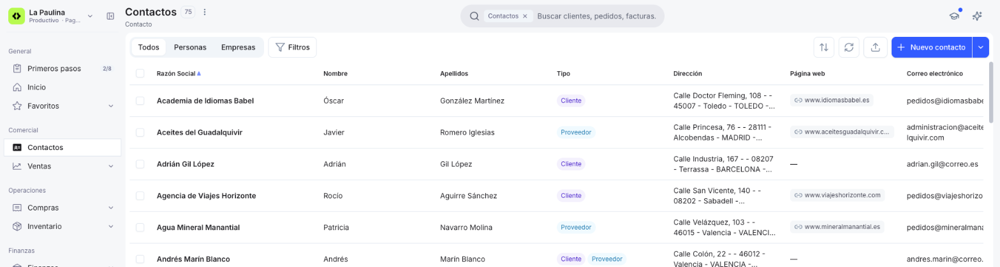
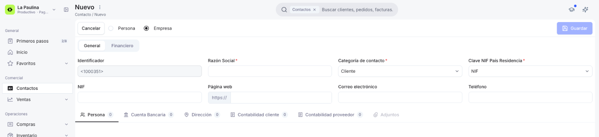
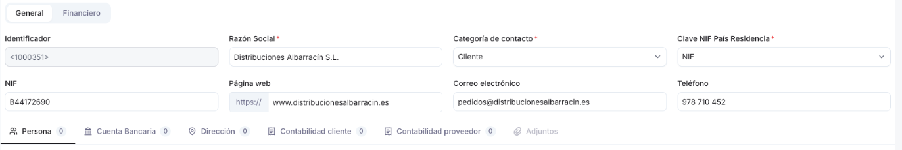
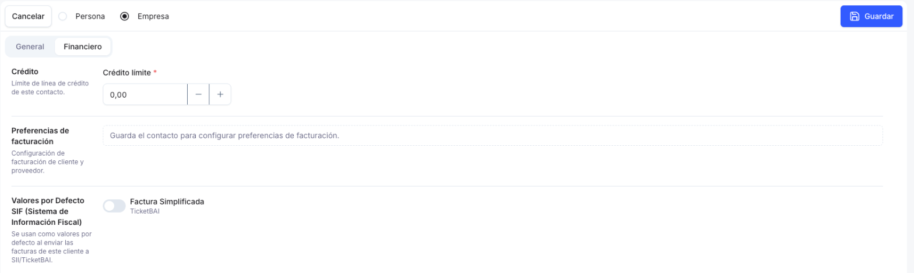
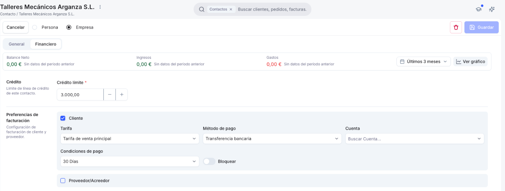

# Cómo crear un contacto

Para poder emitir un documento de venta o de compra, primero necesitas tener el contacto correspondiente cargado en el sistema. Completas sus datos generales, eliges su categoría (que define si es cliente, proveedor o ambos), lo guardas y, después, completas sus preferencias de facturación.

## Datos generales

1. Accede a la ventana [Contactos](https://app.etendo.ai/contacts){target="_blank"} y, desde la vista lista, haz clic en **Nuevo contacto**.

    <figure markdown="span">
      
      <figcaption>Botón Nuevo contacto en la vista lista de Contactos.</figcaption>
    </figure>

2. Elige el tipo de contacto con las opciones **Persona** / **Empresa**, en la parte superior del formulario:

    - **Empresa** (por defecto) — pide **Razón Social**.
    - **Persona** — pide **Nombre** y **Apellidos** en vez de Razón Social. El campo **Teléfono** aparece al pulsar **Mostrar más datos**.

    <figure markdown="span">
      
      <figcaption>Formulario Nuevo contacto, con el tipo Empresa seleccionado.</figcaption>
    </figure>

3. Completa los campos de la solapa **General**:

    - **Razón Social** (Empresa) o **Nombre** y **Apellidos** (Persona) — obligatorios, según el tipo elegido.
    - **Categoría de contacto** — obligatorio. Define el rol del contacto: cada categoría indica si es cliente, proveedor o ambos (por ejemplo, *Cliente*, *Proveedor*, *Acreedor* o *Cliente/Proveedor*). Por defecto, *Cliente*.
    - **Clave NIF País Residencia** — obligatorio. Tipo de documento fiscal: *NIF*, *NIF intracomunitario*, *Pasaporte*, *Certificado de residencia fiscal*, entre otros. Por defecto, *NIF*.
    - **NIF** — número de identificación fiscal.
    - **Página web**, **Correo electrónico** y **Teléfono** — opcionales.

    <figure markdown="span">
      
      <figcaption>Solapa General completada para una empresa.</figcaption>
    </figure>

    !!! info "Identificador"
        El campo **Identificador** muestra un número provisional entre `< >` (ej: `<1000351>`) y se asigna definitivamente al guardar el contacto. No se completa a mano y no se puede modificar después.

4. Si ya tienes los datos a mano, completa las solapas de debajo de la sección General. Puedes dejarlas para más adelante sin problema:

    - **Persona** — personas de contacto vinculadas (nombre, apellido, correo, teléfono y posición). Tiene sentido completarla cuando hablas con distintas personas dentro de la misma empresa, por ejemplo, si las facturas se envían a un responsable y los albaranes a otro.
    - **Cuenta Bancaria** — cuentas bancarias del contacto (por ejemplo, su IBAN).
    - **Dirección** — calle, número, código postal, ciudad, país y región, marcando si se usa para **Envíos**, para **Facturación** o para ambas.
    - **Contabilidad cliente** y **Contabilidad proveedor** — cuentas contables asociadas al contacto según su rol.
    - **Adjuntos** — archivos vinculados al contacto. Se habilita una vez guardado el contacto.

    !!! warning "Dirección obligatoria para facturar"
        Para poder emitir facturas a este contacto, necesitas al menos una dirección marcada para **Facturación** en la solapa **Dirección**. Te recomendamos cargarla aunque dejes el resto de las solapas para más adelante. Si trabajas con TicketBAI, incluye también el código postal.

## Crédito límite (opcional)

1. En la solapa **Financiero**, deja el campo **Crédito límite** en `0,00` o ajústalo si ya sabes qué límite de crédito vas a dar a este contacto.

    <figure markdown="span">
      
      <figcaption>Solapa Financiero de un contacto todavía sin guardar.</figcaption>
    </figure>

    !!! info "Preferencias de facturación"
        Hasta que guardes el contacto, la solapa Financiero no te deja completar las preferencias de facturación: en su lugar verás el mensaje "Guarda el contacto para configurar preferencias de facturación."

## Guardar el contacto

1. Cuando termines de completar los datos que necesites, haz clic en **Guardar** para crear el contacto.

## Completar las preferencias de facturación

1. Con el contacto ya guardado, entra en la solapa **Financiero**. En **Preferencias de facturación** verás marcadas las casillas **Cliente** y/o **Proveedor/Acreedor** según la **Categoría de contacto** que elegiste. Completa los campos de cada bloque:

    - **Cliente** — habilita **Tarifa**, **Método de pago**, **Cuenta**, **Condiciones de pago** y el interruptor **Bloquear** (para impedir nuevos documentos de venta a este contacto). El contacto podrá aparecer en documentos de venta.
    - **Proveedor/Acreedor** — habilita **Tarifa de compra** y los mismos campos, orientados a compras, incluido su propio interruptor **Bloquear**. El contacto podrá aparecer en documentos de compra.

    <figure markdown="span">
      
      <figcaption>Preferencias de facturación de un cliente.</figcaption>
    </figure>

2. Haz clic en **Guardar**.

!!! info "Cambiar el rol de un contacto"
    Las casillas Cliente y Proveedor/Acreedor dependen de la categoría. Si el contacto te compra y te vende a la vez, elige una categoría con ambos roles, como *Cliente/Proveedor*. Qué roles asigna cada categoría se configura en la ventana [Categoría de Contacto](https://app.etendo.ai/business-partner-category){target="_blank"}, en el menú **Configuración**; consulta [Cómo configurar las categorías de contacto](../../../sistema/configuracion/como-configurar-las-categorias-de-contacto/como-configurar-las-categorias-de-contacto.md).

!!! tip "Valores por Defecto SIF"
    En la misma solapa, el apartado **Valores por Defecto SIF** (Sistema de Información Fiscal) muestra un interruptor por cada sistema que tengas activo. Si usas **SII**, activa **Clave por Defecto** y elige en **Clave tipo factura** la clave que se enviará al SII al completar las facturas de este cliente (por defecto, *Factura*). Si usas **TicketBAI**, activa **Factura Simplificada** si a este cliente le emites normalmente facturas simplificadas. Ver [Gestionar tus contactos](../gestionar-tus-contactos/gestionar-tus-contactos.md).

## Crear un contacto desde un documento de venta o compra

También puedes crear un contacto sin salir de un pedido, una factura o un albarán.

1. En el campo **Contacto** del documento, escribe el nombre del contacto. Si no existe, elige **+ Crear contacto**.
2. Se abre la ventana **Nuevo contacto**, con el mismo formulario que en la ventana Contactos y el nombre que has escrito ya cargado. Completa los datos y haz clic en **Guardar**.
3. Haz clic en **Completado**: vuelves al documento con el nuevo contacto ya seleccionado.

!!! info "Completar el resto de los datos"
    Si no has completado todo en ese momento (dirección, cuenta bancaria, preferencias de facturación, etc.), abre el contacto después desde la vista lista de Contactos y sigue los pasos de las secciones anteriores.

## Artículos Relacionados

- [¿Qué es la sección Contactos?](../que-es-la-seccion-contactos/que-es-la-seccion-contactos.md)
- [Importar contactos](../importar-contactos/importar-contactos.md)
- [Gestionar tus contactos](../gestionar-tus-contactos/gestionar-tus-contactos.md)

---
Esta obra está bajo la licencia :material-creative-commons: :fontawesome-brands-creative-commons-by: :fontawesome-brands-creative-commons-sa: [CC BY-SA 2.5 ES](https://creativecommons.org/licenses/by-sa/2.5/es/){target="_blank"} de [Futit Services S.L](https://etendo.software){target="_blank"}.
