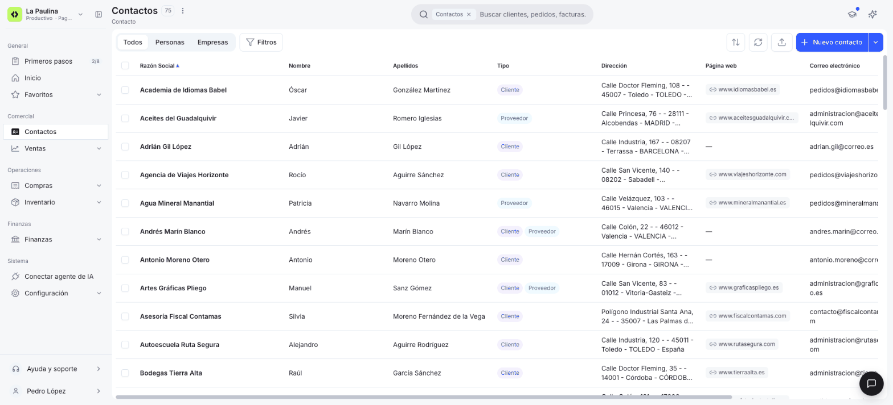
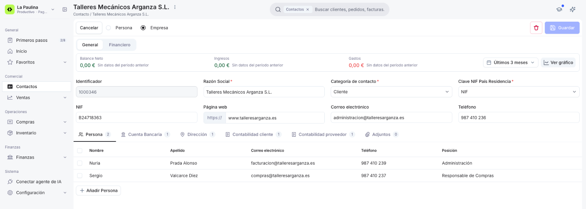
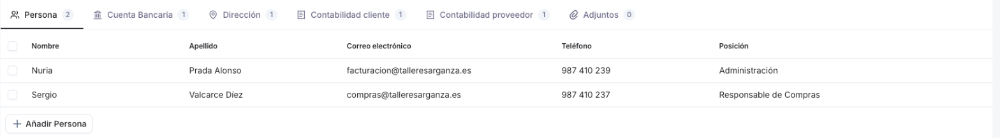
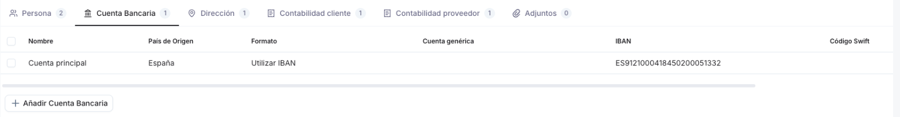
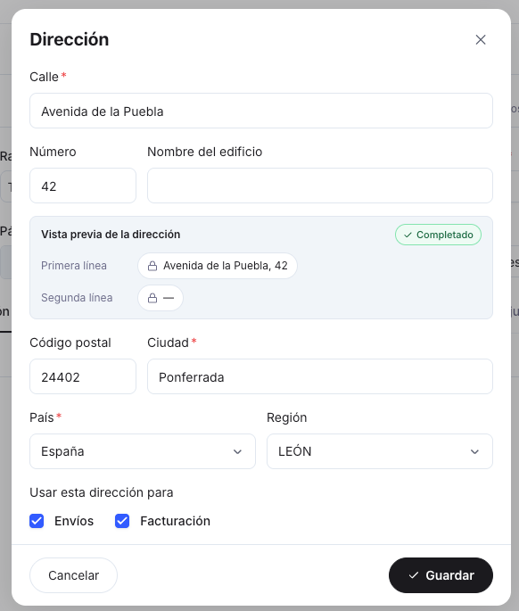
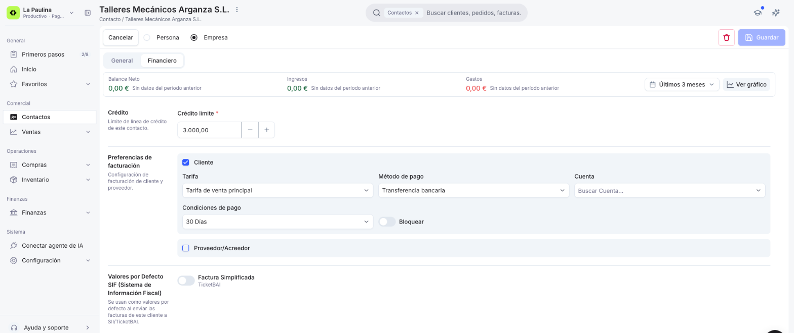
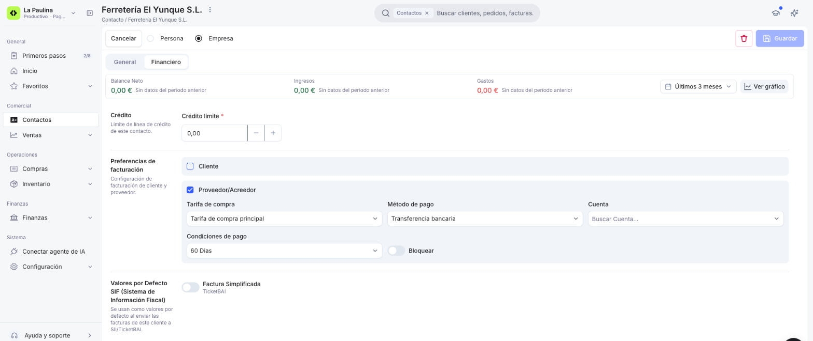
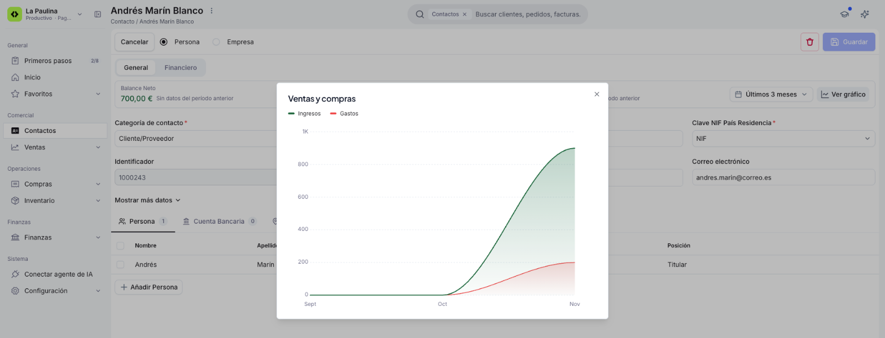

# Gestionar tus contactos

Una vez que tienes contactos cargados en el sistema, necesitas consultarlos, actualizar sus datos o revisar su situación financiera. Este artículo repasa la ventana de [Contactos](https://app.etendo.ai/contacts){target="_blank"} (la vista lista y el formulario) y te explica cómo interpretar cada uno de sus campos y solapas. Si todavía no has creado ningún contacto, empieza por [Cómo crear un contacto](../como-crear-un-contacto/como-crear-un-contacto.md).

## Vista Lista

<figure markdown="span">
  
  <figcaption>Vista lista de Contactos y sus solapas Todos, Personas y Empresas.</figcaption>
</figure>

La lista muestra las columnas **Razón Social**, **Nombre**, **Apellidos**, **Tipo**, **Dirección**, **Página web**, **Correo electrónico** y **Teléfono**. La columna **Tipo** indica el rol del contacto con una etiqueta de color: lavanda para **Cliente** y azul para **Proveedor**. Si un contacto tiene ambos roles, se muestran las dos etiquetas.

Desde la parte superior de la lista puedes:

- **Filtrar por tipo de contacto** con las solapas **Todos**, **Personas** y **Empresas**.
- **Filtrar por condiciones** con el botón **Filtros**: eliges un campo (por ejemplo, **Tipo** para ver solo clientes o solo proveedores), una condición (*Contiene*, *Es*, *Está vacío*, etc.) y un valor. Con **Añadir condición** combinas varios criterios.
- **Ordenar**, **Actualizar** o **Exportar** la lista con los iconos de la derecha.
- **Crear un contacto** con el botón **Nuevo contacto**, o **importar varios a la vez** desde la flecha que tiene al lado (opción **Importar contactos**). Consulta [Importar contactos](../importar-contactos/importar-contactos.md).

Al pasar el cursor sobre una fila aparecen los iconos **Editar** y **Eliminar**.

## Vista Formulario

El formulario se abre al crear un contacto nuevo con **Nuevo contacto** o al hacer clic sobre un contacto de la lista. Contactos no tiene una vista detalle intermedia: el clic lleva directamente al formulario de edición.

En la parte superior tienes el botón **Cancelar**, las opciones **Persona** / **Empresa** que definen el tipo de contacto, el icono **Eliminar** y el botón **Guardar**. Debajo, el formulario se organiza en dos solapas: **General** y **Financiero**.

### Solapa General

<figure markdown="span">
  
  <figcaption>Solapa General de un contacto de tipo Empresa.</figcaption>
</figure>

La solapa **General** presenta los siguientes campos:

- **Identificador** — de solo lectura. Se genera automáticamente al guardar el contacto. Ej: `1000346`.
- **Razón Social** — obligatorio en los contactos de tipo Empresa. Nombre principal del contacto.
- **Nombre** y **Apellidos** — obligatorios en los contactos de tipo Persona, que no muestran el campo Razón Social.
- **Categoría de contacto** — obligatorio. Define el rol del contacto: cada categoría indica si es cliente, proveedor o ambos (por ejemplo, *Cliente*, *Proveedor*, *Acreedor* o *Cliente/Proveedor*).
- **Clave NIF País Residencia** — obligatorio. Tipo de documento fiscal: *NIF*, *NIF intracomunitario*, *Pasaporte*, *Certificado de residencia fiscal*, entre otros.
- **NIF** — número de identificación fiscal.
- **Página web**, **Correo electrónico** y **Teléfono** — opcionales. En los contactos de tipo Persona, el teléfono aparece al pulsar **Mostrar más datos**.

Debajo de estos campos, el formulario incluye seis sub-solapas para ampliar la información del contacto. El número junto a cada una indica cuántos registros tiene.

#### Persona

<figure markdown="span">
  
  <figcaption>Sub-solapa Persona con dos personas de contacto.</figcaption>
</figure>

Registra las personas de contacto vinculadas al cliente o proveedor: **Nombre**, **Apellido**, **Correo electrónico**, **Teléfono** y **Posición**.

Para añadir una, haz clic en **Añadir Persona**, completa la fila y pulsa ++enter++ para guardarla (o ++esc++ para cancelar).

#### Cuenta Bancaria

<figure markdown="span">
  
  <figcaption>Sub-solapa Cuenta Bancaria con una cuenta en formato IBAN.</figcaption>
</figure>

Almacena las cuentas bancarias del contacto. Cada cuenta tiene un **Nombre**, un **País de Origen** y un **Formato**, que indica cómo se identifica la cuenta: *Utilizar IBAN*, *Utilizar Número Genérico de Cuenta*, *Usar código SWIFT + Número Genérico de Cuenta* o *Utilizar Español*. Según el formato, completas **Cuenta genérica**, **IBAN** y/o **Código Swift**.

#### Dirección

<figure markdown="span">
  
  <figcaption>Ventana Dirección de un contacto.</figcaption>
</figure>

Lista las direcciones del contacto e indica, en las columnas **Dir.envíos** y **Dir.factura**, para qué se usa cada una. Al añadir o editar una dirección se abre la ventana **Dirección**, donde completas **Calle**, **Número**, **Nombre del edificio**, **Código postal**, **Ciudad**, **País** y **Región**, y marcas si se usa para **Envíos**, para **Facturación** o para ambas. La **Vista previa de la dirección** te muestra cómo quedará escrita en los documentos.

#### Contabilidad cliente y Contabilidad proveedor

Reflejan las cuentas contables que se asocian por defecto al contacto en su rol de cliente y de proveedor, respectivamente. Por ejemplo, en **Contabilidad cliente** se ven la **Cuenta a Cobrar** y la **Cuenta de Anticipos**. Desde estas sub-solapas es posible modificar las cuentas contables asociadas al contacto.

#### Adjuntos

Permite vincular archivos al contacto: arrastra el archivo a la zona indicada o selecciónalo desde tu ordenador. Admite PDF, Word, Excel, PowerPoint, imágenes, XML, ZIP y RTF. La lista muestra el nombre, el tamaño, la fecha de carga, la última actualización y quién subió cada archivo.

### Solapa Financiero

<figure markdown="span">
  
  <figcaption>Solapa Financiero de un cliente.</figcaption>
</figure>

La solapa **Financiero** se organiza en tres apartados:

- **Crédito** — campo **Crédito límite** (obligatorio, con botones − / +; por defecto `0,00`). Aplica a ambos roles.
- **Preferencias de facturación** — un bloque por rol. Sus casillas se marcan solas según la **Categoría de contacto**:
    - **Cliente**: **Tarifa** (tarifa de venta por defecto, que se hereda en los documentos de venta), **Método de pago** (forma habitual de cobro), **Cuenta** (cuenta financiera donde se registran los cobros), **Condiciones de pago** (plazo de cobro por defecto, ej: *30 Días*) y **Bloquear** (impide crear nuevos documentos de venta para este contacto).
    - **Proveedor/Acreedor**: los mismos campos orientados al ciclo de compras: **Tarifa de compra**, **Método de pago**, **Cuenta**, **Condiciones de pago** y su propio interruptor **Bloquear**.
- **Valores por Defecto SIF (Sistema de Información Fiscal)** — interruptor **Factura Simplificada**. Es el valor que se usa por defecto al enviar las facturas de este cliente a SII o TicketBAI.

<figure markdown="span">
  
  <figcaption>Bloque Proveedor/Acreedor de la solapa Financiero.</figcaption>
</figure>

Para cambiar el rol de un contacto, cambia su **Categoría de contacto**. Qué roles asigna cada categoría se configura en la ventana [Categoría de Contacto](https://app.etendo.ai/business-partner-category){target="_blank"}, en el menú **Configuración**. La etiqueta Cliente/Proveedor de la vista lista refleja estas casillas.

!!! tip "Crear una condición de pago"
    Si el plazo que necesitas no aparece en **Condiciones de pago**, escríbelo en el campo y elige **+ Crear condición de pago**.

## Resumen Financiero y Gráfico

<figure markdown="span">
  
  <figcaption>Gráfico Ventas y compras de un contacto.</figcaption>
</figure>

En el formulario de un contacto ya guardado, una barra superior muestra el **Balance Neto**, los **Ingresos** y los **Gastos** asociados a ese contacto en el período seleccionado, comparados con el período anterior. El selector de período te permite elegir entre **Últimos 3 meses** (por defecto) y **Últimos 6 meses**.

El botón **Ver gráfico** abre la ventana **Ventas y compras**, con un gráfico que compara mes a mes los **Ingresos** (en verde) y los **Gastos** (en rojo) del período elegido.

## Artículos Relacionados

- [Cómo crear un contacto](../como-crear-un-contacto/como-crear-un-contacto.md)
- [Importar contactos](../importar-contactos/importar-contactos.md)
- [¿Qué es la sección Contactos?](../que-es-la-seccion-contactos/que-es-la-seccion-contactos.md)

---
Esta obra está bajo la licencia :material-creative-commons: :fontawesome-brands-creative-commons-by: :fontawesome-brands-creative-commons-sa: [CC BY-SA 2.5 ES](https://creativecommons.org/licenses/by-sa/2.5/es/){target="_blank"} de [Futit Services S.L](https://etendo.software){target="_blank"}.
