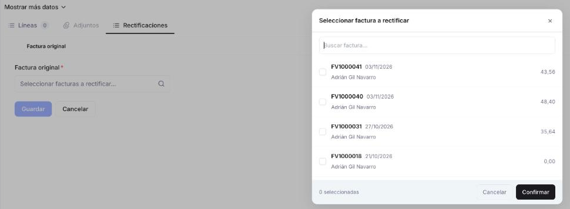

# Crear una factura rectificativa

Cuando una factura que has emitido a un cliente tiene un precio equivocado, le has hecho un descuento después o te ha devuelto mercancía (en este caso, consulta [las formas de crear la rectificativa](#si-hay-devolucion-de-mercancia)), corrígela con una factura rectificativa para que el importe que te debe sea el correcto.

## Antes de empezar: comprueba si puedes reactivar la factura

Si te has equivocado en una factura confirmada, a veces no hace falta rectificativa. Puedes reactivarla con **Reactivar**, en el menú ⋮. La factura vuelve a Borrador, la corriges y la confirmas de nuevo con el mismo número.

Solo puedes reactivarla si se cumplen estas condiciones:

- **La factura no tiene pagos registrados.**
- **Todavía no se ha enviado a Hacienda** por SII o VERI*FACTU, los sistemas con los que Hacienda recibe tus facturas.
- **Si la factura incluye mercancía, todavía no se la has entregado** al cliente.

Una factura solo de servicios, sin mercancía, se puede reactivar si cumple las dos primeras condiciones.

Tienes el detalle de **Reactivar** en [Gestionar tus facturas de venta](../gestionar-tus-facturas-de-venta/gestionar-tus-facturas-de-venta.md#acciones-disponibles).

Si no puedes reactivarla, necesitas una factura rectificativa. Ten en cuenta que una factura confirmada no se puede anular ni borrar. Según lo que necesites, la rectificativa va:

- **Por el importe total** — para dejar la factura sin efecto.
- **Solo por las líneas y cantidades afectadas** — para corregir una parte.

La factura original no desaparece y conserva su número. Así queda constancia de la factura y de su corrección.

## Crear la rectificativa

<figure markdown="span">
  
  <figcaption>Pestaña Rectificaciones: al pulsar + Añadir rectificación se abre el buscador para elegir la factura original.</figcaption>
</figure>

Sigue estos pasos para crear la rectificativa desde la factura. Sirven para cualquier motivo: un precio mal facturado, un descuento, una bonificación o una devolución de mercancía.

1. Entra en **[Ventas > Factura](https://app.etendo.ai/sales-invoice){target="_blank"}** y pulsa **+ Nueva factura**.
2. En **Tipo de documento**, elige *Factura rectificativa*. Una vez guardada, este dato ya no se puede cambiar.
3. Elige el cliente en **Contacto** y rellena el resto de datos igual que en una [factura de venta](../crear-una-factura-de-venta/crear-una-factura-de-venta.md).
4. En la pestaña **Rectificaciones**, pulsa **+ Añadir rectificación**, elige en **Factura original** *(obligatorio)* la factura o facturas que corriges y pulsa **Confirmar**.
5. Añade las líneas de la corrección de una de estas formas:
    - A mano, con **+ Añadir líneas**.
    - Con **Importar desde factura origen**, que trae las líneas de la factura original. Es lo más cómodo para corregir un precio o aplicar un descuento sobre lo ya facturado.
    - Con **Importar desde devolución**, que trae las líneas de un albarán de devolución, cuando la rectificativa corresponde a una devolución.

    Al importar, puedes indicar en cada línea cuántas unidades traer.
6. Revisa los importes y pulsa **Confirmar**.

!!! warning "Indica siempre qué factura corriges"
    Si no indicas en **Rectificaciones** qué factura corrige, la rectificativa no se puede confirmar.

## Si hay devolución de mercancía

Si el cliente te devuelve productos, tienes tres formas de crear la rectificativa:

- **Al confirmar el albarán de devolución.** Se genera ya rellena con los productos devueltos y los precios de la factura original. Se crea en Borrador: revísala y pulsa **Confirmar**. Consulta [Confirmar el albarán de devolución](../crear-y-gestionar-devoluciones/crear-y-gestionar-devoluciones.md#confirmar-el-albaran-de-devolucion).
- **Desde el albarán de devolución ya Completado.** Si no la has generado al confirmarlo, pulsa **Crear Factura Rectificativa** en el albarán. Consulta la misma sección, [Confirmar el albarán de devolución](../crear-y-gestionar-devoluciones/crear-y-gestionar-devoluciones.md#confirmar-el-albaran-de-devolucion).
- **Desde la factura**, siguiendo los [pasos de arriba](#crear-la-rectificativa) e importando las líneas del albarán de devolución.

## Qué pasa después

La rectificativa no sustituye a la factura original: solo recoge la diferencia, en más o en menos. Lo que pasa después depende de si esa diferencia baja o sube el importe:

- **Si lo baja** (una devolución, un descuento o un precio facturado de más) — la rectificativa aparece con importe en negativo en la lista de facturas. Al confirmarla, queda como un importe a favor del cliente, que no se descuenta automáticamente de la factura original. Consulta [Aplicar saldo a favor o crédito disponible](../anadir-pagos-a-tu-factura-de-venta/anadir-pagos-a-tu-factura-de-venta.md#aplicar-saldo-a-favor-o-credito-disponible-opcional).
- **Si lo sube** (un precio facturado de menos) — el cliente te debe la diferencia. Queda pendiente de cobro, como en cualquier factura.

!!! info "Para tu asesor"
    - *Fecha*: la fecha contable de la factura rectificativa tiene que caer en un periodo contable abierto.
    - *Tipo*: es una rectificativa por diferencias. Etendo no admite rectificativas por sustitución.

## Artículos Relacionados

- [Crear y gestionar devoluciones](../crear-y-gestionar-devoluciones/crear-y-gestionar-devoluciones.md)
- [Gestionar tus facturas de venta](../gestionar-tus-facturas-de-venta/gestionar-tus-facturas-de-venta.md)
- [Crear una factura de venta](../crear-una-factura-de-venta/crear-una-factura-de-venta.md)

---
Esta obra está bajo la licencia :material-creative-commons: :fontawesome-brands-creative-commons-by: :fontawesome-brands-creative-commons-sa: [CC BY-SA 2.5 ES](https://creativecommons.org/licenses/by-sa/2.5/es/){target="_blank"} de [Futit Services S.L](https://etendo.software){target="_blank"}.
