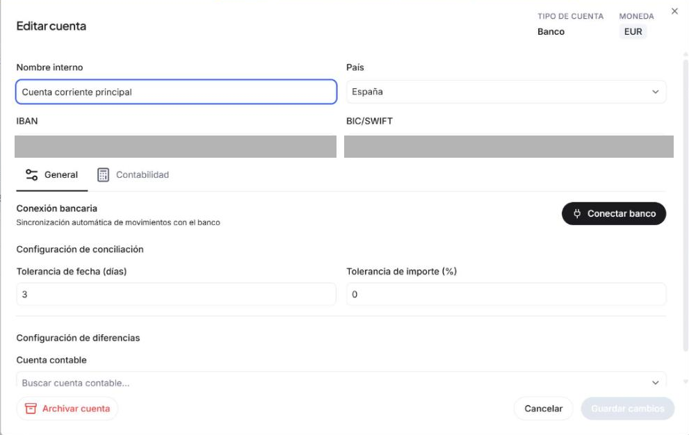
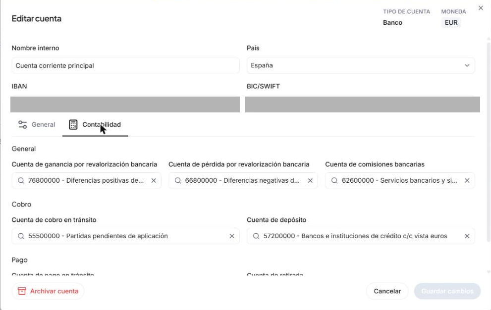

---
tags:
    - Cuentas
    - Finanzas
    - Editar cuenta
description: Aprende a modificar el nombre, los datos bancarios y la configuración de conciliación de cualquier cuenta desde la sección Cuentas de Etendo.
---

# Cómo editar una cuenta

Desde la sección **Cuentas** puedes actualizar en cualquier momento el nombre, el país, los datos bancarios y la configuración de conciliación de las cuentas que ya tienes dadas de alta. Los cambios se aplican en cuanto guardas.

## Abrir la ventana de edición

1. Ve a **[Finanzas > Cuentas](https://app.etendo.ai/financial-account){target="_blank"}**.
2. Localiza la cuenta que quieres modificar.
3. Haz clic en **Editar cuenta** al final de la fila.

La ventana de edición muestra en su encabezado el **Tipo de cuenta** (Banco, Caja o Tarjeta) y la **Moneda** de esa cuenta. Los campos disponibles varían según el tipo. Las pestañas **General** y **Contabilidad** organizan la configuración.

## Pestaña General

La pestaña **General** reúne los datos de identificación de la cuenta y la configuración para conciliar movimientos.

=== "Banco"

    - **Nombre interno** — el nombre con el que identificas la cuenta dentro de Etendo.
    - **País** — país donde está domiciliada la cuenta.
    - **IBAN** — número internacional de cuenta bancaria.
    - **BIC/SWIFT** — código identificador del banco emisor.

    **Conexión bancaria**

    Haz clic en **Conectar banco** para activar la sincronización automática de movimientos con el banco. Si la cuenta ya está conectada, aquí puedes gestionarla.

    **Configuración de conciliación**

    Define el margen de tolerancia que Etendo usa para emparejar los movimientos del banco con tus cobros y pagos registrados:

    - **Tolerancia de fecha (días)** — número de días de diferencia que se permiten al comparar fechas. El valor por defecto es `3`.
    - **Tolerancia de importe (%)** — diferencia de importe, en porcentaje, que se acepta al comparar movimientos. El valor por defecto es `0`.

    **Configuración de diferencias**

    - **Cuenta contable** — cuenta del plan de cuentas donde se registran las diferencias que surjan durante la conciliación.

=== "Caja"

    - **Nombre interno** — el nombre con el que identificas la caja dentro de Etendo.
    - **País** — país donde opera la caja.

    **Configuración de diferencias**

    - **Cuenta contable** — cuenta del plan de cuentas donde se registran las diferencias de conciliación.

=== "Tarjeta"

    - **Nombre interno** — el nombre con el que identificas la tarjeta dentro de Etendo.
    - **País** — país de la tarjeta.
    - **IBAN** — número de cuenta asociada a la tarjeta. Este campo es opcional.

    **Conexión bancaria**

    Haz clic en **Conectar banco** para activar la sincronización automática de movimientos de la tarjeta.

    **Configuración de conciliación**

    - **Tolerancia de fecha (días)** — número de días de diferencia que se permiten al comparar fechas.
    - **Tolerancia de importe (%)** — diferencia de importe, en porcentaje, que se acepta al comparar movimientos.

    **Configuración de diferencias**

    - **Cuenta contable** — cuenta del plan de cuentas donde se registran las diferencias de conciliación.

## Pestaña Contabilidad

La pestaña **Contabilidad** define qué cuentas de tu plan de cuentas se usan al registrar los movimientos de cobro y pago de esta cuenta.

!!! info "Para tu asesor"

    Estos valores los configura habitualmente tu asesor contable. Si no sabes qué escribir en cada campo, consúltale antes de hacer cambios.

    === "Banco"

        - **Cuenta de ganancia por revalorización bancaria** — donde se anota la ganancia que surge cuando el tipo de cambio es favorable.
        - **Cuenta de pérdida por revalorización bancaria** — donde se anota la pérdida cuando el tipo de cambio es desfavorable.
        - **Cuenta de comisiones bancarias** — donde se registran las comisiones que cobra el banco.

        **Cobro**

        - **Cuenta de cobro en tránsito** — cuenta puente que registra los cobros mientras están pendientes de confirmar en el banco.
        - **Cuenta de depósito** — cuenta donde se contabiliza el cobro una vez confirmado.

        **Pago**

        - **Cuenta de pago en tránsito** — cuenta puente que registra los pagos mientras están pendientes de confirmar en el banco.
        - **Cuenta de retirada** — cuenta donde se contabiliza el pago una vez confirmado.

    === "Caja"

        **Cobro**

        - **Cuenta de cobro en tránsito** — cuenta puente para los cobros pendientes de confirmación.
        - **Cuenta de depósito** — cuenta donde se contabiliza el cobro confirmado.

        **Pago**

        - **Cuenta de pago en tránsito** — cuenta puente para los pagos pendientes de confirmación.
        - **Cuenta de retirada** — cuenta donde se contabiliza el pago confirmado.

    === "Tarjeta"

        **Cobro**

        - **Cuenta de cobro en tránsito** — cuenta puente para los cobros pendientes.
        - **Cuenta de depósito** — cuenta donde se contabiliza el cobro confirmado.

        **Pago**

        - **Cuenta de pago en tránsito** — cuenta puente para los pagos pendientes.
        - **Cuenta de retirada** — cuenta donde se contabiliza el pago confirmado.

## Guardar los cambios

Cuando hayas terminado, haz clic en **Guardar cambios**. Si prefieres cancelar sin guardar, haz clic en **Cancelar**.

!!! tip "Archivar una cuenta"
    Si ya no usas una cuenta, puedes archivarla desde este mismo lugar usando el botón **Archivar cuenta**. Una cuenta archivada deja de aparecer en la lista activa pero conserva su historial. Consulta [Cómo conectar, desconectar, archivar o eliminar una cuenta](../como-conectar-desconectar-desactivar-o-eliminar-una-cuenta-bancaria/como-conectar-desconectar-desactivar-o-eliminar-una-cuenta-bancaria.md) para más detalles.

---

**Artículos relacionados**

- [Cómo añadir y configurar un banco, tarjeta o caja](../como-anadir-y-configurar-un-banco-tarjeta-o-caja/como-anadir-y-configurar-un-banco-tarjeta-o-caja.md)
- [Cómo conectar, desconectar, archivar o eliminar una cuenta](../como-conectar-desconectar-desactivar-o-eliminar-una-cuenta-bancaria/como-conectar-desconectar-desactivar-o-eliminar-una-cuenta-bancaria.md)
- [Cómo conciliar movimientos](../como-conciliar-o-desconciliar-movimientos-contra-documentos/como-conciliar-o-desconciliar-movimientos-contra-documentos.md)
