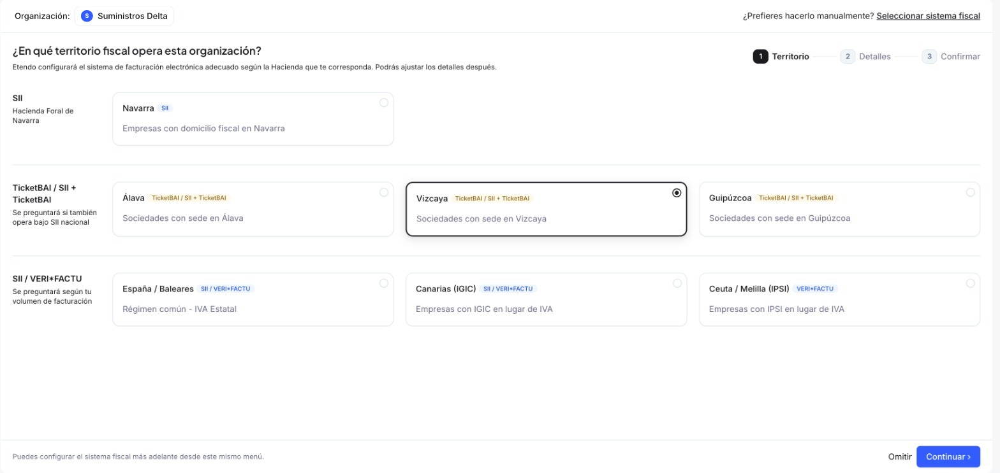
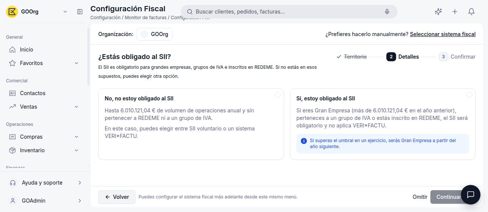
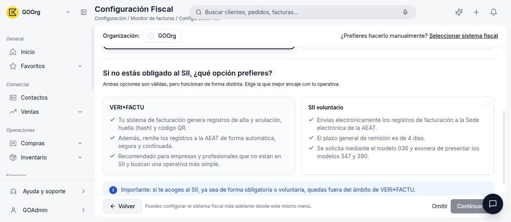
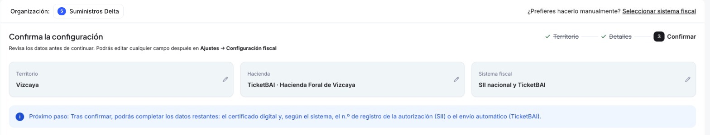

# Cómo Activar tu Sistema Fiscal

Antes de poder facturar, cada organización debe activar el **sistema fiscal** que le corresponde según el territorio en el que opera, ya sea **SII**, **TicketBAI** o **VERI\*FACTU**. Etendo incluye un asistente guiado que determina automáticamente qué sistema aplica a partir de tu territorio fiscal y tu volumen de facturación, con una alternativa manual para configurarlo tú mismo.

## Cómo Activar el Sistema Fiscal (Asistente Guiado)

1. Ve a **[Configuración > Configuración Fiscal](https://app.etendo.ai/fiscal-config){target="_blank"}**.
2. **Paso 1 — Territorio:** selecciona el territorio fiscal en el que opera tu organización.

    <figure markdown="span">
      
      <figcaption>Paso 1: los territorios se agrupan según el sistema fiscal que les corresponde (SII para Navarra; TicketBAI o SII + TicketBAI para Álava, Vizcaya y Guipúzcoa; SII o VERI*FACTU para España/Baleares y Canarias; solo VERI*FACTU para Ceuta/Melilla).</figcaption>
    </figure>

3. **Paso 2 — Detalles:** el asistente hace preguntas adicionales según el territorio elegido. Para **España/Baleares y Canarias**, primero pregunta si estás obligado al SII:

    <figure markdown="span">
      
      <figcaption>El SII es obligatorio para Grandes Empresas (más de 6.010.121,04 € de volumen de operaciones en el año anterior), grupos de IVA e inscritos en REDEME.</figcaption>
    </figure>

    Si no estás obligado, el asistente te deja elegir entre **VERI\*FACTU** y **SII voluntario**:

    <figure markdown="span">
      
      <figcaption>VERI*FACTU: tu software genera y remite automáticamente los registros de facturación. SII voluntario: envías tú los registros a la AEAT en un plazo de 4 días y te exonera de los modelos 347 y 390.</figcaption>
    </figure>

    !!! warning "Son excluyentes"
        Si te acoges al SII, ya sea de forma obligatoria o voluntaria, quedas fuera del ámbito de VERI\*FACTU.

    Para **Ceuta/Melilla**, el asistente no hace esta pregunta: pasa directo del territorio a confirmar **VERI\*FACTU**, la única opción disponible. El SII es un mecanismo de declaración del IVA, y Ceuta y Melilla no tributan por IVA sino por IPSI, así que el SII no aplica ahí ni de forma obligatoria ni voluntaria.

4. **Paso 3 — Confirmar:** revisa el territorio, la Hacienda y el sistema fiscal resultante antes de continuar.

    <figure markdown="span">
      
      <figcaption>Resumen final: territorio, Hacienda y sistema fiscal que se va a activar.</figcaption>
    </figure>

5. Pulsa **Confirmar**. A continuación podrás completar los detalles operativos de tu sistema fiscal (por ejemplo, autorizaciones AEAT y certificado digital para SII, o territorio y envío automático para TicketBAI). Ver [SII](../sii/sii.md) y [TicketBAI](../ticketbai/ticketbai.md).

!!! tip "Territorios forales"
    Para **Navarra**, el sistema fiscal es siempre **SII** y el asistente salta directo del paso 1 al paso 3 (confirmar), sin preguntas adicionales. Para **Álava, Vizcaya y Guipúzcoa**, el paso 2 pregunta "¿También debes declarar por SII?", con las opciones **Solo TicketBAI** o **TicketBAI + SII**, y el resultado es **TicketBAI**, combinado o no con SII.

## Cómo Configurarlo Manualmente

Si prefieres elegir el sistema fiscal tú mismo, sin responder a las preguntas del asistente:

1. En **Configuración Fiscal**, pulsa **¿Prefieres hacerlo manualmente? Seleccionar sistema fiscal**.
2. Elige el territorio.
3. Elige el sistema fiscal disponible para ese territorio (por ejemplo, para Navarra la única opción es SII).
4. Pulsa **Continuar** y confirma.

## Después de Activarlo

Una vez confirmado, **[Configuración > Configuración Fiscal](https://app.etendo.ai/fiscal-config){target="_blank"}** deja de mostrar el asistente y pasa a llamarse **Configuración Fiscal** con el sufijo de tu sistema activo (por ejemplo, *"Configuración Fiscal SII + TBAI"*). La pantalla tiene:

- **Una pestaña por sistema** (por ejemplo, **SII** y **TicketBAI**) con sus detalles operativos y el **Certificado digital**. Ver [SII](../sii/sii.md#detalles-operativos) y [TicketBAI](../ticketbai/ticketbai.md#detalles-operativos).
- **El panel Estado**, a la derecha: resume el sistema activo y si está en **Producción**, el territorio fiscal, la Hacienda, si la operativa nacional (SII) está activa, la validez del certificado y la fecha de activación.
- **Guardar**, que solo se habilita cuando cambias algún dato.
- **Cambiar SIF**, en el menú **⋮** junto a Guardar, para volver a elegir el sistema fiscal.

Con un sistema fiscal configurado, la ventana **Organización** muestra además la sección **Certificado digital** (ver [Cómo gestionar tu organización](../../sistema/configuracion/como-gestionar-tu-organizacion/como-gestionar-tu-organizacion.md#secciones-fiscales)).

!!! info "Sistema fiscal no es lo mismo que modelo fiscal"
    Lo que activas aquí es el sistema por el que envías tus facturas (SII, TicketBAI o VERI\*FACTU). Los modelos de declaración periódica, como el [Modelo 303](../modelo-303/modelo-303.md) o el [Modelo 349](../modelo-349/modelo-349.md), se activan aparte, desde el [Catálogo de modelos](../glosario-de-impuestos/glosario-de-impuestos.md#catalogo-de-modelos) de **Finanzas > Modelos Fiscales**.

## Artículos Relacionados

- [SII](../sii/sii.md)
- [TicketBAI](../ticketbai/ticketbai.md)
- [VERI\*FACTU](../verifactu/verifactu.md)

---
Esta obra está bajo la licencia :material-creative-commons: :fontawesome-brands-creative-commons-by: :fontawesome-brands-creative-commons-sa: [CC BY-SA 2.5 ES](https://creativecommons.org/licenses/by-sa/2.5/es/){target="_blank"} de [Futit Services S.L](https://etendo.software){target="_blank"}.
