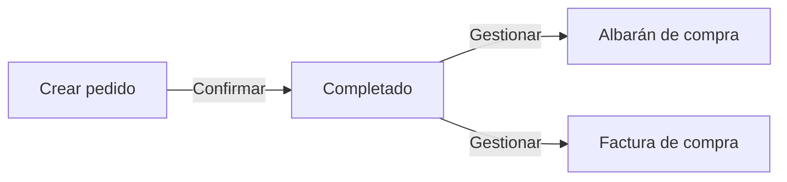
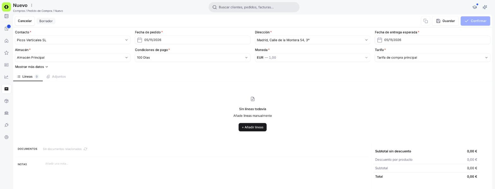
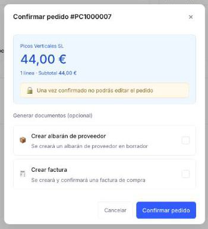

# Crear un pedido de compra

Sigue esta guía cuando necesites solicitar productos o servicios a un proveedor: el pedido de compra formaliza la solicitud y, una vez confirmado, te permite generar el albarán de recepción y la factura correspondientes.

**Antes de empezar**, necesitas tener:

- El [contacto](../../../comercial/contactos/que-es-la-seccion-contactos/que-es-la-seccion-contactos.md) del proveedor cargado, con el rol **Proveedor** activo.
- Al menos una dirección configurada para ese contacto.

---

## Crear el pedido

<figure markdown="span">
  
  <figcaption>Formulario de un Pedido de compra nuevo: cabecera con los campos requeridos, el enlace Mostrar más datos y la pestaña Líneas todavía vacía.</figcaption>
</figure>

1. Accede a **[Compras > Pedido de Compra](https://app.etendo.ai/purchase-order){target="_blank"}** y haz clic en **+ Nuevo pedido**.
2. Completa la cabecera:
    - **Contacto** *(requerido)* — proveedor al que se dirige el pedido. Al seleccionarlo, autocompleta **Dirección**, **Método de pago**, **Condiciones de pago**, **Moneda** y **Tarifa**.
    - **Fecha de pedido** *(requerido)* — por defecto la fecha actual; editable.
    - **Dirección** *(requerido)* — heredada del contacto; editable para este documento.
    - **Fecha de entrega esperada** *(requerido)* — fecha prevista de recepción; por defecto hoy, editable. Exclusiva de este documento.
    - **Almacén** *(requerido)* — donde se recibirá la mercancía; por defecto tu almacén, editable.
    - **Condiciones de pago** *(requerido)*, **Moneda** *(requerido)*, **Tarifa** *(requerido)* — heredados del contacto; editables para este documento.

    !!! tip "Campos tras Mostrar más datos"
        Haz clic en **Mostrar más datos** para ver dos campos más: **Nº documento**, que se asigna automáticamente al guardar y no es editable, y **Método de pago**, heredado del contacto y no requerido. Para volver a ocultarlos, usa **Mostrar menos datos**.

3. Haz clic en **Guardar**. El pedido queda en Borrador y ya puedes añadir las líneas.
4. Si necesitas adjuntar algún archivo de referencia (por ejemplo, la cotización del proveedor), usa la pestaña **Adjuntos** — admite PDF, Word, Excel, PowerPoint e imágenes.

Una vez guardado el pedido, la barra superior muestra **Cancelar**, la etiqueta **Borrador** y las acciones **Eliminar** (icono de papelera), **Copiar enlace**, **Clonar**, **Guardar** y **Confirmar**. **Confirmar** está deshabilitado mientras el pedido no tenga líneas.

## Añadir las líneas

<figure markdown="span">
  
  <figcaption>Pestaña Líneas con los productos y servicios incluidos en el Pedido de compra.</figcaption>
</figure>

Usa **+ Añadir líneas** para incorporar cada producto o servicio. El producto se elige en un buscador; si todavía no lo tienes cargado, puedes crearlo desde ahí con **+ Crear producto**. Cada línea tiene estas columnas:

- **Producto** — autocompleta descripción, precio de tarifa e impuesto; editable para este pedido.
- **Descripción** — precompletada desde el producto; editable por línea.
- **Cant. pedido** — cantidad solicitada al proveedor. Por defecto 1.
- **Unidad** - unidad del producto; no editable.
- **Precio** — precio del producto según la tarifa de compra; editable.
- **% de descuento** — descuento aplicado sobre el precio de la línea.
- **Impuesto** — tipo impositivo aplicable, heredado del producto.
- **Importe bruto de línea** — **Precio** × **Cant. pedido**, menos el descuento, más el impuesto de la línea.

Para guardar una línea pulsa ++enter++ o haz clic fuera de la fila; para cancelar sin guardar, pulsa ++esc++.

### Totales y notas

<figure markdown="span">
  
  <figcaption>Panel de totales con desglose de subtotal, descuento, impuesto e importe final.</figcaption>
</figure>

El panel de totales muestra **Subtotal sin descuento**, **Descuento por producto**, **Subtotal**, **Impuesto** y **Total**, con la opción de añadir un descuento global vía **+ Añadir descuento total**. El campo **Notas** admite observaciones internas, no incluidas en el PDF enviado al proveedor.

## Confirmar el pedido

<figure markdown="span">
  
  <figcaption>Popup Confirmar pedido, con el resumen del pedido y las casillas Crear albarán de proveedor y Crear factura, desmarcadas por defecto.</figcaption>
</figure>

Cuando el pedido esté listo, haz clic en **Confirmar** para pasarlo a estado Completado. Se abre el popup **Confirmar pedido**, que muestra el proveedor, el importe y el número de líneas con el subtotal.

En la sección **Generar documentos (opcional)** puedes marcar, si quieres, una o las dos casillas:

- **Crear albarán de proveedor** — crea un [albarán de compra](../crear-y-gestionar-albaranes-de-compra/crear-y-gestionar-albaranes-de-compra.md) en Borrador.
- **Crear factura** — crea y confirma una [factura de compra](../crear-una-factura-de-compra/crear-una-factura-de-compra.md): la factura queda directamente en estado Completado.

Pulsa **Confirmar pedido** para terminar, o **Cancelar** para volver al formulario. Si no marcas ninguna casilla, el pedido queda Completado sin documentos asociados y puedes generarlos más adelante: abre el pedido y haz clic en el botón **Gestionar recepción y factura** de la barra superior, que abre el popup **Generar factura** con las mismas dos opciones. Consulta [Gestionar tus pedidos de compra](../gestionar-tus-pedidos-de-compra/gestionar-tus-pedidos-de-compra.md#gestionar-los-documentos-pendientes) para el detalle de esa gestión.

!!! warning "El pedido no se puede editar tras confirmar"
    Una vez confirmado, el pedido queda bloqueado. Verifica las líneas, cantidades y precios antes de confirmar.

## Artículos Relacionados

- [Gestionar tus pedidos de compra](../gestionar-tus-pedidos-de-compra/gestionar-tus-pedidos-de-compra.md)
- [Registrar una factura de compra](../crear-una-factura-de-compra/crear-una-factura-de-compra.md)
- [Contactos](../../../comercial/contactos/que-es-la-seccion-contactos/que-es-la-seccion-contactos.md)

---
Esta obra está bajo la licencia :material-creative-commons: :fontawesome-brands-creative-commons-by: :fontawesome-brands-creative-commons-sa: [CC BY-SA 2.5 ES](https://creativecommons.org/licenses/by-sa/2.5/es/){target="_blank"} de [Futit Services S.L](https://etendo.software){target="_blank"}.
