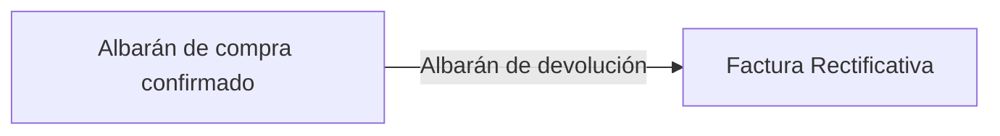
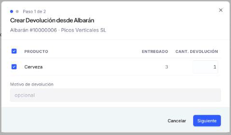
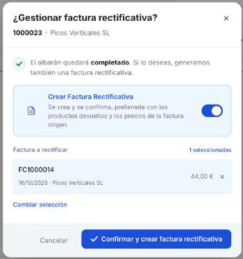

# Crear una devolución de compra

Sigue esta guía cuando devuelvas mercancía a un proveedor. La devolución se registra con un **Albarán de devolución**, vinculado al albarán de compra (recepción) con el que has recibido la mercancía. Al confirmarla, puedes registrar en el mismo paso la **Factura Rectificativa** que la acompaña.

Si no devuelves mercancía y solo hay que corregir un importe (por ejemplo, un precio mal facturado o un descuento del proveedor), consulta [Registrar una factura rectificativa](../registrar-una-factura-rectificativa/registrar-una-factura-rectificativa.md).

**Antes de empezar**, necesitas tener:

- Un **albarán de compra (recepción)** ya confirmado, del que se vaya a devolver la mercancía.

---

## Registrar una devolución física

### Desde el albarán de compra

<figure markdown="span">
  
  <figcaption>Paso 1 de 2 del asistente Crear Devolución desde Albarán: productos del albarán con la cantidad entregada, la cantidad a devolver y el campo Motivo de devolución.</figcaption>
</figure>

Es la forma más directa, porque la devolución hereda el proveedor y los productos del albarán de compra (recepción) del que devuelves la mercancía.

1. Abre el [albarán de compra](../crear-y-gestionar-albaranes-de-compra/crear-y-gestionar-albaranes-de-compra.md) ya Completado y haz clic en **Crear Devolución**. Se abre el asistente **Crear Devolución desde Albarán**.
2. En el **Paso 1 de 2**, marca las casillas de los productos que devuelves. Para cada uno ves la cantidad **ENTREGADO** y puedes ajustar la **CANT. DEVOLUCIÓN** si no devuelves todo lo recibido. Si quieres, completa el campo **Motivo de devolución** (opcional). Pulsa **Siguiente**.
3. En el **Paso 2 de 2**, revisa el resumen del **Albarán de Devolución** que se va a crear, con los productos, las cantidades y el **Total**. Pulsa **Crear Devolución**, o **Atrás** si necesitas corregir algo.
4. Aparece el popup **Devolución de compra creada**. Pulsa **Ver devolución** para abrirla: queda en estado **Borrador**, con el **Albarán origen** ya completado.
5. Revisa la devolución y confírmala (consulta [Confirmar la devolución](#confirmar-la-devolucion)).

### Desde Compras > Albarán de devolución

1. Accede a **[Compras > Albarán de devolución](https://app.etendo.ai/return-to-vendor-shipment){target="_blank"}** y haz clic en **+ Nuevo albarán de devolución**.
2. Completa la cabecera: **Contacto** (proveedor), **Fecha del movimiento**, **Almacén** y **Dirección**.
3. Debajo de las líneas, haz clic en **Añadir desde Albarán** para incorporar las líneas que devuelves. El campo **Albarán origen** es de solo lectura.
4. Ajusta las cantidades a devolver por línea si no se devuelve la totalidad de lo recibido.
5. Guarda la devolución y confírmala (consulta [Confirmar la devolución](#confirmar-la-devolucion)).

### Confirmar la devolución

<figure markdown="span">
  
  <figcaption>Popup ¿Gestionar factura rectificativa?, con el interruptor Crear Factura Rectificativa activado por defecto y la factura a rectificar ya preseleccionada.</figcaption>
</figure>

Al hacer clic en **Confirmar** aparece el popup **¿Gestionar factura rectificativa?**, con el número de la devolución y el proveedor. Desde ahí completas la devolución y, si quieres, generas la Factura Rectificativa en el mismo paso:

- El interruptor **Crear Factura Rectificativa** viene activado por defecto. La Factura Rectificativa se crea y se confirma —queda en estado Completado—, prellenada con los productos devueltos y los precios de la factura de origen.
- La sección **Factura a rectificar** muestra la factura de origen ya preseleccionada (número, fecha, proveedor e importe), con el contador de facturas seleccionadas. Usa **Cambiar selección** si necesitas rectificar otra factura.
- Pulsa **Confirmar y crear factura rectificativa** para completar la devolución y generar la Factura Rectificativa en el mismo paso. Al terminar, el popup **Factura rectificativa de compra creada** te lo confirma.

Puedes desactivar el interruptor si no quieres generar la Factura Rectificativa en este paso. Más adelante podrás registrarla desde la factura, importando las líneas de esta devolución: consulta [Registrar una factura rectificativa](../registrar-una-factura-rectificativa/registrar-una-factura-rectificativa.md).

Para consultar las devoluciones ya registradas, su estado de factura y los documentos relacionados, ve a [Gestionar tus albaranes de devolución](../gestionar-tus-albaranes-de-devolucion/gestionar-tus-albaranes-de-devolucion.md).

## Artículos Relacionados

- [Crear y gestionar albaranes de compra](../crear-y-gestionar-albaranes-de-compra/crear-y-gestionar-albaranes-de-compra.md)
- [Gestionar tus albaranes de devolución](../gestionar-tus-albaranes-de-devolucion/gestionar-tus-albaranes-de-devolucion.md)
- [Gestionar tus facturas de compra](../gestionar-tus-facturas-de-compra/gestionar-tus-facturas-de-compra.md)

---
Esta obra está bajo la licencia :material-creative-commons: :fontawesome-brands-creative-commons-by: :fontawesome-brands-creative-commons-sa: [CC BY-SA 2.5 ES](https://creativecommons.org/licenses/by-sa/2.5/es/){target="_blank"} de [Futit Services S.L](https://etendo.software){target="_blank"}.
