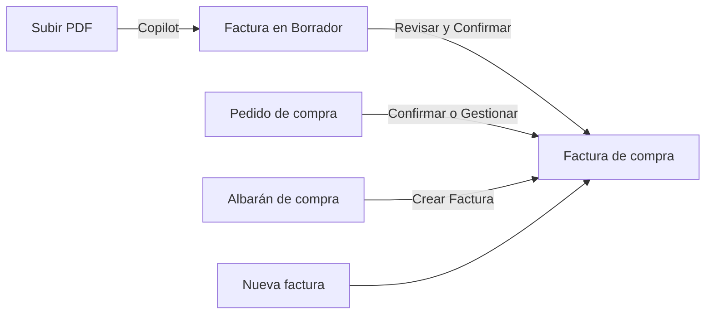
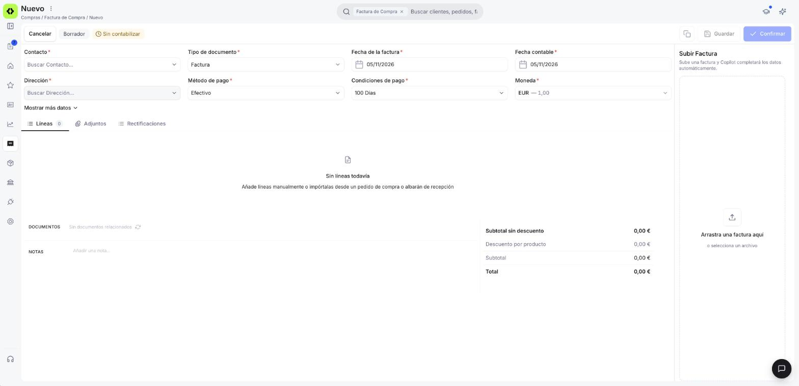
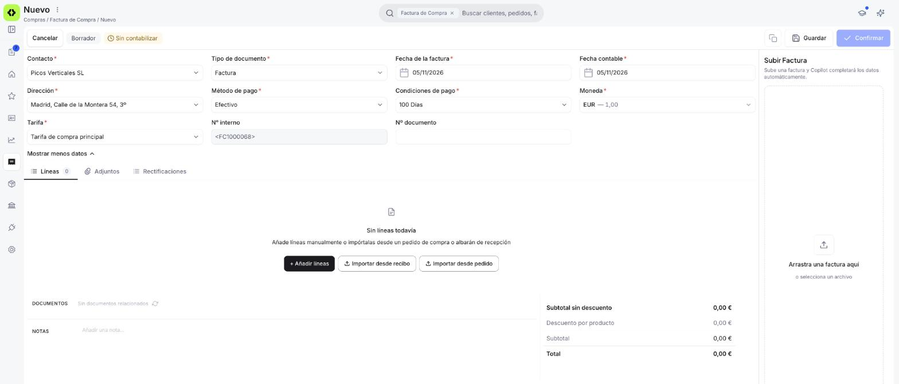

# Registrar una factura de compra

Cuando un proveedor te envía una factura, regístrala aquí para saber cuánto le debes y cuándo tienes que pagarle.

Puedes registrarla de tres formas: subiendo el PDF para que Copilot la rellene por ti, [a mano](#registrar-la-factura-a-mano), o generándola desde un [pedido de compra](#generar-la-factura-desde-un-pedido-de-compra) o un [albarán de compra](#generar-la-factura-desde-un-albaran-de-compra) que ya estén confirmados.

No hace falta que tengas el proveedor dado de alta antes de empezar: si todavía no existe, puedes crearlo mientras registras la factura, tanto a mano como con Copilot.

!!! tip "La forma más rápida: deja que Copilot lea el PDF"
    Copilot es el agente de inteligencia artificial de Etendo: lee la factura por ti y rellena los datos. Si tienes la factura del proveedor en PDF, súbela en el panel **Subir Factura** de una factura nueva y pulsa **Extraer y completar**. Copilot detecta el proveedor, la fecha, el número y las líneas. Después, Copilot guarda la factura en Borrador para que la revises y la confirmes.

    Si el proveedor o algún producto todavía no están dados de alta en Etendo, puedes crearlos sobre la marcha ([crear el proveedor](../escanear-facturas-de-compra-con-copilot/escanear-facturas-de-compra-con-copilot.md#crear-el-proveedor-durante-el-proceso), [crear los productos](../escanear-facturas-de-compra-con-copilot/escanear-facturas-de-compra-con-copilot.md#crear-los-productos-durante-el-proceso)). Tienes el paso a paso en [Escanear facturas de compra con Copilot](../escanear-facturas-de-compra-con-copilot/escanear-facturas-de-compra-con-copilot.md).

---

## Registrar la factura a mano

<figure markdown="span">
  
  <figcaption>Una factura nueva en Borrador: arriba, los datos principales con los campos obligatorios; debajo, las pestañas Líneas, Adjuntos y Rectificaciones; a la derecha, el panel Subir Factura.</figcaption>
</figure>

Si no tienes el PDF del proveedor a mano, o prefieres escribir los datos tú, puedes registrar la factura desde el formulario.

1. Entra en **[Compras > Factura](https://app.etendo.ai/purchase-invoice){target="_blank"}** y pulsa **+ Nueva factura**. La factura se abre en estado **Borrador**. Arriba tienes los botones **Cancelar**, **Clonar**, **Guardar** y **Confirmar**.
2. Rellena los datos principales de la factura:
    - **Contacto** *(obligatorio)* — el proveedor que te ha enviado la factura. Si aún no lo tienes dado de alta, puedes crearlo desde el mismo desplegable con **+ Crear contacto**. Al elegirlo, se rellenan solos la **Dirección**, el **Método de pago**, las **Condiciones de pago** y la **Tarifa** que tengas configurados para ese proveedor.
    - **Tipo de documento** *(obligatorio)* — elige *Factura* para una compra normal. *Factura rectificativa* sirve para corregir el importe de una factura de compra, por ejemplo un precio mal facturado: consulta [Registrar una factura rectificativa](../registrar-una-factura-rectificativa/registrar-una-factura-rectificativa.md). Si devuelves mercancía, lo más sencillo es generarla desde el albarán de devolución: consulta [Crear una devolución de compra](../crear-una-devolucion-de-compra/crear-una-devolucion-de-compra.md#registrar-una-devolucion-fisica). Una vez guardada la factura, este dato ya no se puede cambiar.
    - **Fecha de la factura** *(obligatorio)* — la fecha que aparece en la factura del proveedor. Viene con la fecha de hoy y puedes cambiarla.
    - **Fecha contable** *(obligatorio)* — la fecha que cuenta para tu contabilidad. Si no la cambias, toma la fecha de la factura. Tienes más detalle en la nota *Para tu asesor*, al final de esta sección.
    - **Dirección** *(obligatorio)*, **Método de pago** *(obligatorio)* y **Condiciones de pago** *(obligatorio)* — vienen de la ficha del proveedor. Puedes cambiarlos solo para esta factura. Con las condiciones de pago, Etendo calcula por sí mismo la fecha de vencimiento, es decir, cuándo tienes que pagar.
    - **Moneda** *(obligatorio)* — viene en euros (**EUR**). Si el proveedor te factura en otra moneda, cámbiala y Etendo aplica el tipo de cambio del día de la factura. Si tu proveedor o tu asesor te indican otro, puedes cambiarlo a mano en la pestaña **Tipos de cambio**.
3. Pulsa **Mostrar más datos** para ver los campos que no aparecen a primera vista. Para volver a ocultarlos, pulsa **Mostrar menos datos**.
    - **Tarifa** *(obligatorio)* — la lista de precios de compra que se aplica. Viene de la ficha del proveedor y puedes cambiarla.
    - **Nº interno** — el número con el que Etendo guardará la factura, por ejemplo `FC1000015`. Lo ves antes de guardar la factura y no se puede cambiar.
    - **Nº documento** — el número que el proveedor ha puesto en su factura. Lo escribes tú. Si todavía no lo tienes, puedes dejarlo en blanco.

La factura tiene además dos pestañas útiles:

- **Adjuntos** — para guardar junto a la factura otros archivos relacionados.
- **Rectificaciones** — solo se usa en una *Factura rectificativa*: muestra la factura o facturas que corrige.

!!! info "Para tu asesor"
    - *Fecha contable*: es la fecha con la que la factura entra en la contabilidad. Tiene que caer en un periodo contable abierto.
    - *Tipo de cambio*: si la factura va en otra moneda, Etendo aplica el tipo de cambio registrado, que se actualiza automáticamente cada noche. Si lo cambias a mano, el ajuste queda anotado en la pestaña **Tipos de cambio**. Ese es el tipo de cambio que se usa después en la contabilidad.

!!! info "Nº interno y Nº documento"
    El **Nº interno** es la numeración propia de Etendo para tus facturas de compra, por ejemplo `FC1000015` para una factura o `FCR1000003` para una Factura Rectificativa. Es distinto del **Nº documento**, que es el número que ha puesto el proveedor. Así puedes identificar cada factura dentro de Etendo aunque varios proveedores usen numeraciones parecidas.

## Añadir las líneas

<figure markdown="span">
  
  <figcaption>Pestaña Líneas de una factura con el proveedor ya elegido y todavía sin productos: el mensaje "Sin líneas" todavía y las opciones + Añadir líneas, Importar desde recibo e Importar desde pedido.</figcaption>
</figure>

En las líneas indicas qué te ha facturado el proveedor: productos, cantidades y precios.

Mientras la factura no tiene líneas, la pestaña **Líneas** muestra el mensaje "Sin líneas todavía — Añade líneas manualmente o impórtalas desde un pedido de compra o albarán de recepción". Los botones para añadir líneas aparecen cuando eliges el **Contacto**. Hasta entonces solo verás ese mensaje.

Con el proveedor elegido, tienes tres formas de añadir productos:

- **+ Añadir líneas** — añade una línea vacía para que la rellenes tú.
- **Importar desde recibo** — trae las líneas de un [albarán de compra](../crear-y-gestionar-albaranes-de-compra/crear-y-gestionar-albaranes-de-compra.md) (recepción) que ya tengas de ese mismo proveedor.
- **Importar desde pedido** — trae las líneas de un pedido de compra confirmado de ese mismo proveedor.

Las dos opciones de importar abren un buscador con los albaranes o pedidos de ese proveedor que aún tienen algo pendiente de facturar. Puedes desplegar cada uno para elegir líneas concretas y, en cada línea, indicar cuántas unidades quieres facturar: no hace falta importar todas las unidades de la línea, por ejemplo si el proveedor te factura solo una parte. También puedes marcar varios (o usar **Seleccionar todo**) y traerlos a la vez con **Importar seleccionadas**. Así, una sola factura puede agrupar varios albaranes o pedidos del mismo proveedor, por ejemplo si te factura a fin de mes todas las entregas.

Al elegir un producto, su descripción, su precio de tarifa y su impuesto se rellenan solos. Puedes cambiar los tres en cada línea.

La columna **Importe bruto de línea** se calcula sola: precio × cantidad facturada, menos el descuento de la línea, más el impuesto de la línea.

Para guardar una línea, pulsa ++enter++ o pulsa fuera de la fila. Para salir sin guardar, pulsa ++esc++.

### Totales, notas y documentos

<figure markdown="span">
  
  <figcaption>Factura con varias líneas y cantidades: el panel de totales calcula el Subtotal y el Total a partir de todas las líneas.</figcaption>
</figure>

El panel de totales te muestra de un vistazo cuánto le debes al proveedor por esta factura:

- **Subtotal sin descuento**
- **Descuento por producto**
- **Subtotal**
- **Impuesto**
- **Total**

Si el proveedor te ha hecho un descuento sobre toda la factura, añádelo con **+ Añadir descuento total**.

En **Notas** puedes apuntar observaciones para ti o tu equipo. No salen en el PDF de la factura.

La sección **Documentos** muestra el pedido o el albarán del que sale la factura, si lo hay.

## Generar la factura desde un pedido de compra

Si ya tienes un pedido de compra, no hace falta crear la factura desde cero. Cómo generarla depende de si el pedido ya está confirmado:

- **Al confirmar el pedido** — marca la opción **Crear factura** en la ventana **Confirmar pedido**.
- **Si el pedido ya está confirmado** — abre el pedido y pulsa **Gestionar recepción y factura**, arriba. Si ya has recibido toda la mercancía, el botón se llama **Gestionar factura**. En la ventana **Generar factura**, elige **Crear factura** y pulsa **Crear →**.

En los dos casos, la factura se crea y se confirma sola, y queda en estado Completado. Ya viene con el proveedor, la dirección, las condiciones de pago y las líneas pendientes del pedido. Consulta [Gestionar tus pedidos de compra](../gestionar-tus-pedidos-de-compra/gestionar-tus-pedidos-de-compra.md#gestionar-los-documentos-pendientes).

## Generar la factura desde un albarán de compra

Si ya has recibido la mercancía y el albarán de compra está confirmado, puedes generar la factura directamente desde él, sin pasar por un pedido:

1. En el albarán, pulsa **Crear Factura**, arriba. Se abre la ventana **Generar factura**.
2. Elige la **Tarifa** que quieres aplicar y pulsa **Crear →**.

La factura se crea y se confirma sola, y queda en estado Completado. Ya viene con el proveedor y las líneas del albarán. Consulta [Crear y gestionar albaranes de compra](../crear-y-gestionar-albaranes-de-compra/crear-y-gestionar-albaranes-de-compra.md#3-genera-la-factura-o-la-devolucion).

## Artículos Relacionados

Cuando guardas la factura, - [Escanear facturas de compra con Copilot](../escanear-facturas-de-compra-con-copilot/escanear-facturas-de-compra-con-copilot.md)
- [Añadir pagos a tu factura de compra](../anadir-pagos-a-tu-factura-de-compra/anadir-pagos-a-tu-factura-de-compra.md)
- [Gestionar tus facturas de compra](../gestionar-tus-facturas-de-compra/gestionar-tus-facturas-de-compra.md)

---
Esta obra está bajo la licencia :material-creative-commons: :fontawesome-brands-creative-commons-by: :fontawesome-brands-creative-commons-sa: [CC BY-SA 2.5 ES](https://creativecommons.org/licenses/by-sa/2.5/es/){target="_blank"} de [Futit Services S.L](https://etendo.software){target="_blank"}.
