# Escanear facturas de compra con Copilot

Sigue esta guía cuando recibas la factura de un proveedor y quieras registrarla sin escribir los datos a mano. **Copilot**, el agente de IA integrado en la interfaz de Etendo (un agente dentro de la propia plataforma que te ayuda a consultar información y a ejecutar acciones sin salir del sistema), lee el PDF de la factura, detecta el proveedor, la fecha, el número y las líneas, y completa la factura de compra por ti. Tú solo revisas lo que encontró y confirmas.

**Antes de empezar**, necesitas tener:

- La factura del proveedor en **PDF**. Si la tienes en papel o como imagen, escanéala o guárdala como PDF.
- El [contacto](../../../comercial/contactos/que-es-la-seccion-contactos/que-es-la-seccion-contactos.md) del proveedor, con el rol **Proveedor** activo y al menos una dirección marcada como dirección de facturación. Si todavía no existe, Copilot te deja crearlo con esos datos durante el proceso (consulta [Crear el proveedor durante el proceso](#crear-el-proveedor-durante-el-proceso)).

Si algún producto de la factura no está en tu catálogo, puedes crearlo durante el proceso (consulta [Crear los productos durante el proceso](#crear-los-productos-durante-el-proceso)).

!!! warning "Solo se admiten archivos PDF"
    Si subes otro formato, el panel muestra el aviso "Solo se admiten archivos PDF." y no lo procesa.

## Subir la factura y revisar los datos

1. Accede a **[Compras > Factura](https://app.etendo.ai/purchase-invoice){target="_blank"}** y haz clic en **+ Nueva factura**.
2. En el panel **Subir Factura**, a la derecha del formulario, arrastra el PDF a la zona "Arrastra una factura aquí" o haz clic en **selecciona un archivo**.

    <figure markdown="span">
      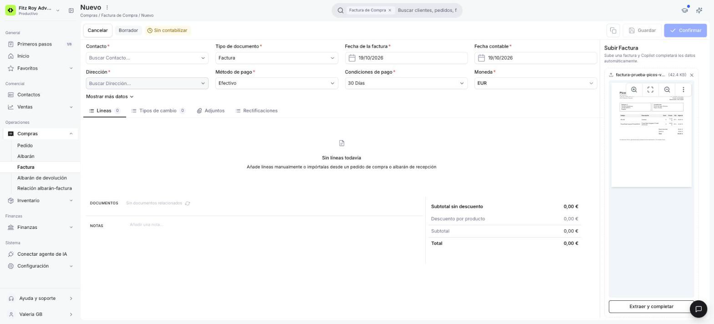
      <figcaption>Factura nueva todavía vacía, con el PDF del proveedor cargado en el panel Subir Factura: nombre, tamaño, vista previa y el botón Extraer y completar.</figcaption>
    </figure>

3. El panel muestra el nombre y el tamaño del archivo y una vista previa del documento. Revisa que sea la factura correcta y pulsa **Extraer y completar**: la lectura no empieza sola. Mientras Copilot lee el documento, el botón cambia a "Procesando…" y aparece el mensaje "Extrayendo datos de la factura…". Puede tardar unos segundos.
4. En el popup **Datos detectados en la factura**, revisa el **Proveedor**, el **Nº documento** y la **Fecha de la factura** que encontró Copilot. Cada dato tiene un interruptor, activado por defecto. Pulsa **Continuar**.

    <figure markdown="span">
      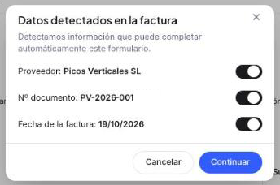
      <figcaption>Popup Datos detectados en la factura, con un interruptor por cada dato de cabecera que Copilot encontró en el documento.</figcaption>
    </figure>

    Si el proveedor no está cargado en Etendo, el interruptor de **Proveedor** aparece apagado y **Continuar** queda deshabilitado: créalo como se explica en [Crear el proveedor durante el proceso](#crear-el-proveedor-durante-el-proceso) y vuelve a este paso. Si prefieres hacerlo más tarde, pulsa **Cancelar**: el popup se cierra sin completar nada y el PDF sigue cargado para volver a pulsar **Extraer y completar**.

5. En el popup **Líneas detectadas en la factura**, confirma o ajusta cada línea: puedes editar la **DESCRIPCIÓN**, la **CANTIDAD** y el **PRECIO TARIFA**, y elegir el **IMPUESTO**. Pulsa **Completar automáticamente**. Si Copilot no reconoce algún producto de la factura, se abre el popup **Asociar productos**: consulta [Crear los productos durante el proceso](#crear-los-productos-durante-el-proceso).

    <figure markdown="span">
      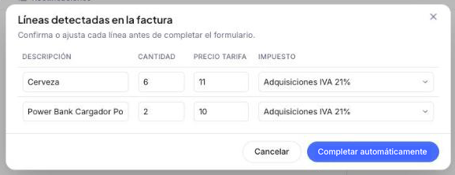
      <figcaption>Popup Líneas detectadas en la factura, con las líneas que Copilot leyó del documento listas para revisar antes de completar el formulario.</figcaption>
    </figure>

6. Etendo completa y guarda la factura en **Borrador**, con su **Nº interno**. Un aviso confirma que el proceso se ejecutó. La factura queda con:
    - **Contacto** y **Dirección** del proveedor detectado.
    - **Nº documento** (tras **Mostrar más datos**) y **Fecha de la factura** del documento.
    - Las líneas vinculadas a los productos de tu catálogo, con cantidad, precio e impuesto.
    - El PDF original en la pestaña **Adjuntos** y a la vista en el panel derecho.

    <figure markdown="span">
      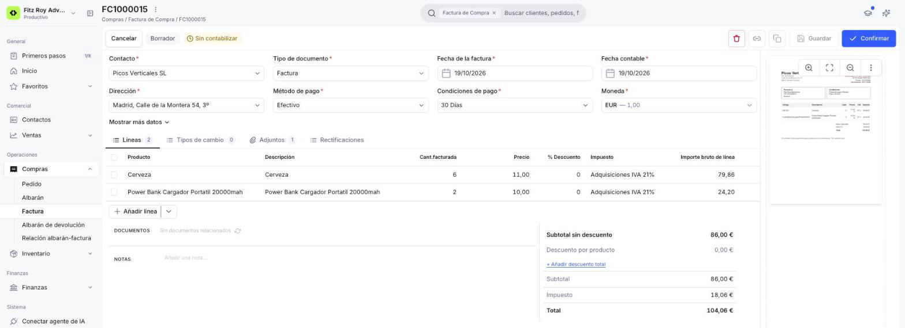
      <figcaption>Factura en Borrador completada a partir del PDF: cabecera, líneas y totales cargados, y el documento a la vista en el panel derecho.</figcaption>
    </figure>

## Crear el proveedor durante el proceso

<figure markdown="span">
  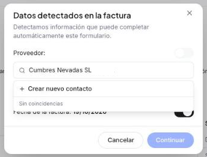
  <figcaption>Proveedor no encontrado: Sin coincidencias y la opción + Crear nuevo contacto.</figcaption>
</figure>

Si Copilot no encuentra el proveedor entre tus contactos, en el popup **Datos detectados en la factura** ves un buscador con el nombre del proveedor tal como figura en el PDF y el mensaje "Sin coincidencias". Puedes crear el proveedor ahí mismo, sin salir del flujo:

1. Elige **+ Crear nuevo contacto** en la lista. Se abre el modal **Nuevo contacto**, en modo Empresa, con la **Razón Social**, la **Categoría de contacto** (Proveedor) y el **NIF** ya cargados desde el PDF.

    <figure markdown="span">
      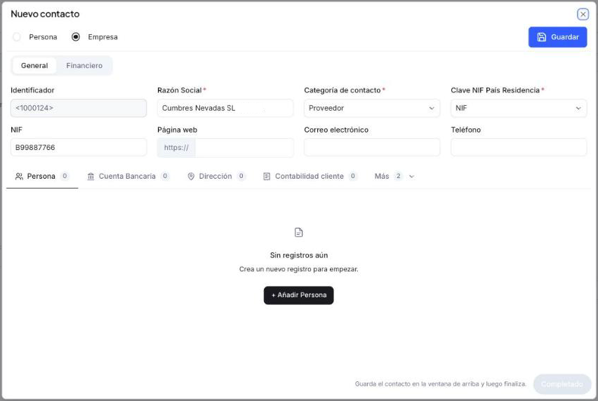
      <figcaption>Modal Nuevo contacto con los datos del proveedor leídos del PDF y el botón Completado todavía deshabilitado.</figcaption>
    </figure>

2. Revisa los datos y pulsa **Guardar**. Etendo valida el NIF: si no es correcto, muestra "El dígito de control no coincide. Revisa el número." y no guarda el contacto hasta que lo corrijas. Si el NIF es correcto, un aviso "Registro creado" confirma que se creó el contacto y el botón **Completado** se habilita.
3. Se abre el popup **Dirección**, con la dirección del PDF ya cargada (primera línea, código postal, ciudad y país) y las casillas **Dir.envíos** y **Dir.factura** marcadas. La **Región** queda vacía y puedes completarla si la necesitas. Revísala y pulsa **Guardar**. La dirección aparece en la pestaña Dirección del modal.

    <figure markdown="span">
      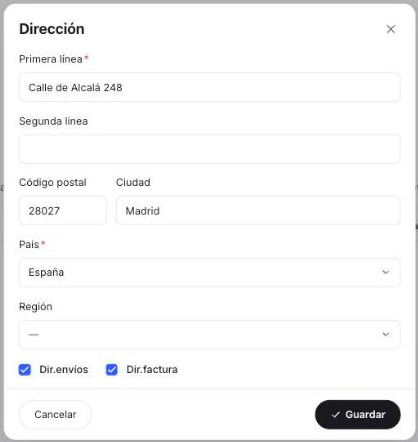
      <figcaption>Popup Dirección del nuevo proveedor, con la dirección leída del PDF marcada como de envío y de facturación.</figcaption>
    </figure>

4. Pulsa **Completado**. Vuelves al popup **Datos detectados en la factura**: el proveedor queda seleccionado, su interruptor se activa y **Continuar** se habilita. Sigue desde el paso 4 de [Subir la factura y revisar los datos](#subir-la-factura-y-revisar-los-datos).

    <figure markdown="span">
      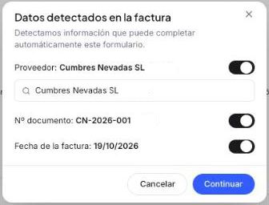
      <figcaption>Proveedor recién creado ya seleccionado en el popup, con su interruptor activado y Continuar habilitado.</figcaption>
    </figure>

## Crear los productos durante el proceso

<figure markdown="span">
  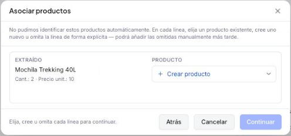
  <figcaption>Popup Asociar productos: por cada línea no identificada, lo extraído del PDF y el selector Producto, con Continuar deshabilitado.</figcaption>
</figure>

Si Copilot no identifica algún producto de la factura, al pulsar **Completar automáticamente** se abre el popup **Asociar productos**, que muestra por cada línea lo **EXTRAÍDO** del PDF (nombre, cantidad y precio unitario) y un selector **PRODUCTO**. En cada línea puedes elegir un producto existente, crear uno nuevo u omitir la línea; según indica el popup, las líneas omitidas puedes añadirlas manualmente más tarde. **Continuar** se habilita cuando todas las líneas están resueltas.

1. Abre el selector **PRODUCTO** de la línea. Muestra un buscador con el nombre detectado y las opciones **+ Crear producto** y **Omitir línea**; si no hay coincidencias, indica "Sin resultados".

    <figure markdown="span">
      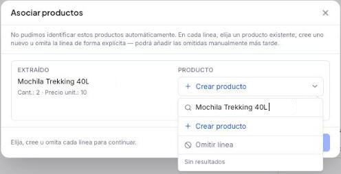
      <figcaption>Opciones del selector Producto: buscador con el nombre detectado, + Crear producto y Omitir línea.</figcaption>
    </figure>

2. Elige **+ Crear producto**. Se abre el modal **Nuevo producto**, con los campos requeridos ya completados: **Nombre** y **Clave de búsqueda** (tomados del PDF), **Unidad de medida** y **Categoría fiscal**.

    <figure markdown="span">
      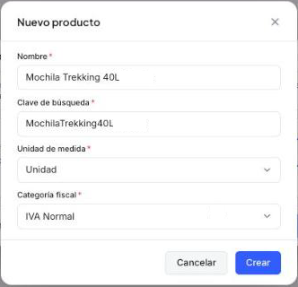
      <figcaption>Modal Nuevo producto con los datos leídos del PDF y los campos requeridos ya completados.</figcaption>
    </figure>

3. Revisa los datos y pulsa **Crear**. El producto queda asociado a la línea en el popup **Asociar productos**.

    <figure markdown="span">
      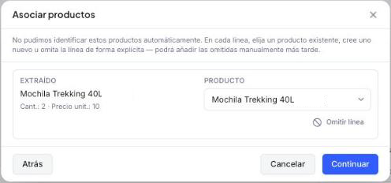
      <figcaption>Producto recién creado asociado a la línea, con Continuar ya habilitado.</figcaption>
    </figure>

4. Cuando todas las líneas estén resueltas, pulsa **Continuar**. Etendo guarda la factura en **Borrador** con todas las líneas, incluida la del producto nuevo, como en el paso 6 de [Subir la factura y revisar los datos](#subir-la-factura-y-revisar-los-datos).

## Revisar y confirmar la factura

Revisa los datos, sobre todo el contacto y los productos de cada línea, y pulsa **Confirmar** cuando todo coincida con el documento del proveedor. A partir de ahí puedes consultarla en [Gestionar tus facturas de compra](../gestionar-tus-facturas-de-compra/gestionar-tus-facturas-de-compra.md) y registrar su pago con [Añadir pagos a tu factura de compra](../anadir-pagos-a-tu-factura-de-compra/anadir-pagos-a-tu-factura-de-compra.md).

## Artículos Relacionados

- [Registrar una factura de compra](../crear-una-factura-de-compra/crear-una-factura-de-compra.md)
- [Gestionar tus facturas de compra](../gestionar-tus-facturas-de-compra/gestionar-tus-facturas-de-compra.md)
- [Añadir pagos a tu factura de compra](../anadir-pagos-a-tu-factura-de-compra/anadir-pagos-a-tu-factura-de-compra.md)

---
Esta obra está bajo la licencia :material-creative-commons: :fontawesome-brands-creative-commons-by: :fontawesome-brands-creative-commons-sa: [CC BY-SA 2.5 ES](https://creativecommons.org/licenses/by-sa/2.5/es/){target="_blank"} de [Futit Services S.L](https://etendo.software){target="_blank"}.
