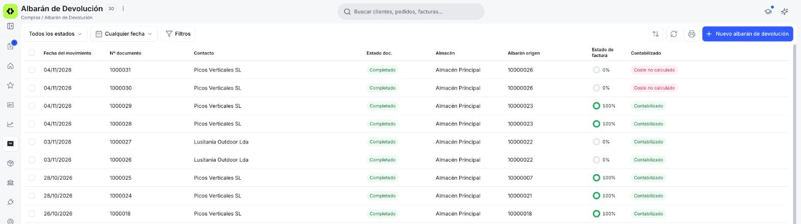
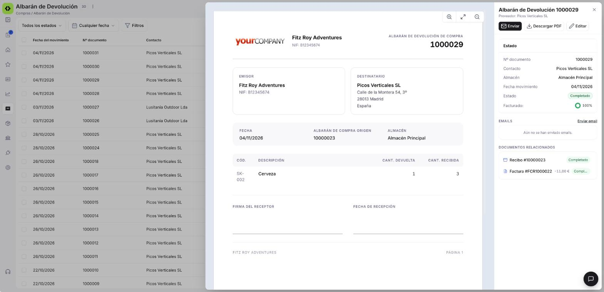
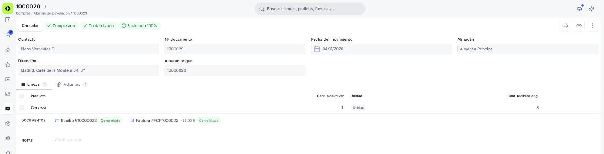

# Gestionar tus albaranes de devolución

Una vez que has registrado devoluciones de mercancía a tus proveedores, vas a necesitar consultarlas, revisar si ya tienen su Factura Rectificativa o enviarlas al proveedor. Este artículo repasa la ventana de **[Compras > Albarán de devolución](https://app.etendo.ai/return-to-vendor-shipment){target="_blank"}**: la vista lista, la vista detalle, el formulario y las acciones disponibles. Si todavía no has creado ninguna, empieza por [Crear una devolución de compra](../crear-una-devolucion-de-compra/crear-una-devolucion-de-compra.md).

## Vista Lista

<figure markdown="span">
  
  <figcaption>Vista lista de Albarán de devolución, con las columnas Albarán origen y Estado de factura.</figcaption>
</figure>

La vista lista muestra todas las devoluciones con estas columnas:

- **Fecha del movimiento** — fecha en que sale la mercancía devuelta.
- **Nº documento**.
- **Contacto** — proveedor al que se devuelve la mercancía.
- **Estado doc.** — el estado del documento (Borrador o Completado).
- **Almacén** — almacén desde el que sale la mercancía.
- **Albarán origen** — el [albarán de compra](../crear-y-gestionar-albaranes-de-compra/crear-y-gestionar-albaranes-de-compra.md) (recepción) del que se devuelve la mercancía.
- **Estado de factura** — indicador de progreso, en porcentaje, de cuánto de la devolución ya está reflejado en una Factura Rectificativa.
- **Contabilizado** — indica si el documento ya está registrado en la contabilidad de la empresa.

!!! info "Devoluciones en Borrador sin albarán origen"
    Una devolución creada con **+ Nuevo albarán de devolución** puede quedar en Borrador sin albarán origen: en ese caso, la columna **Albarán origen** aparece vacía. Las devoluciones creadas con el asistente **Crear Devolución desde Albarán** ya lo traen completado. Consulta [Crear una devolución de compra](../crear-una-devolucion-de-compra/crear-una-devolucion-de-compra.md#desde-compras-albaran-de-devolucion).

Los selectores **Todos los estados** y **Cualquier fecha**, en la barra superior, filtran la lista por estado del documento y por fecha, y **Filtros** habilita condiciones adicionales. A la derecha tienes los iconos para ordenar, refrescar e imprimir la lista, y el botón **+ Nuevo albarán de devolución** para registrar una devolución nueva.

## Vista Detalle

<figure markdown="span">
  
  <figcaption>Panel de detalle de un Albarán de devolución completado, con el bloque de estado, la sección EMAILS y los DOCUMENTOS RELACIONADOS.</figcaption>
</figure>

Al hacer clic sobre una devolución de la lista se abre el panel de detalle, titulado **Albarán de Devolución** seguido del número, con el proveedor debajo. Desde la cabecera del panel puedes:

- **Enviar** — abre el envío por email al proveedor. Solo aparece en devoluciones Completadas.
- **Descargar PDF** — descarga la devolución en formato PDF. En una devolución en Borrador aparece deshabilitado.
- **Editar** — abre el formulario completo (consulta [Vista Formulario](#vista-formulario)).

El panel muestra además:

- Bloque de estado con **Nº documento**, **Contacto**, **Almacén**, **Fecha movimiento**, **Estado** y **Facturado**, este último con el porcentaje de la devolución ya facturado en una Factura Rectificativa.
- Sección **EMAILS** — historial de correos enviados, con el enlace **Enviar email**. Si todavía no has enviado ninguno, muestra "Aún no se han enviado emails".
- Sección **DOCUMENTOS RELACIONADOS** — los documentos vinculados a la devolución, cada uno con su número, importe cuando corresponde y estado. Por ejemplo, el albarán de compra (recepción) de origen y la Factura Rectificativa generada.

## Vista Formulario

<figure markdown="span">
  
  <figcaption>Formulario de un Albarán de devolución completado, con las etiquetas de estado en la barra superior y las columnas Cant. a devolver y Cant. recibida orig.</figcaption>
</figure>

Al hacer clic en **Editar** se abre el formulario. La barra superior cambia según el estado:

- **En Borrador** — **Cancelar**, las etiquetas **Borrador** y **Sin contabilizar**, y las acciones **Eliminar**, **Copiar enlace**, **Guardar** y **Confirmar**.
- **En Completado** — **Cancelar** y las etiquetas de estado: **Completado**, el estado de contabilización (por ejemplo, **Contabilizado**) y el progreso de facturación (por ejemplo, **Facturado 50%**). A la derecha están los iconos **Imprimir**, **Copiar enlace** y el menú ⋮, que ofrece **Contabilizar** cuando la devolución está sin contabilizar. A diferencia del albarán de compra, la devolución no tiene la acción **Clonar**.

**Cabecera**

- **Contacto** — proveedor al que se devuelve la mercancía.
- **Nº documento**.
- **Fecha del movimiento**.
- **Almacén** — desde dónde sale la mercancía.
- **Dirección** — dirección del proveedor.
- **Albarán origen** — albarán de compra (recepción) del que se devuelve la mercancía. Es de solo lectura.

**Pestañas Líneas y Adjuntos**

La pestaña **Líneas** muestra, por cada producto:

- **Producto**.
- **Cant. a devolver** — unidades que devuelves al proveedor.
- **Cant. recibida orig.** — unidades que recibiste en el albarán origen, como referencia al ajustar la cantidad a devolver.

En Borrador, debajo de las líneas, el botón **Añadir desde Albarán** permite incorporar líneas. La pestaña **Adjuntos** permite vincular archivos a la devolución. Debajo de las líneas, la sección **DOCUMENTOS** muestra los documentos relacionados y el campo **NOTAS** permite añadir observaciones internas.

## Estados del Documento

| Estado | Descripción |
|---|---|
| Borrador | En preparación. Es el estado en que se crea la devolución. Si la creas con el asistente **Crear Devolución desde Albarán**, ya trae el Albarán origen completado; si la creas con **+ Nuevo albarán de devolución**, puede quedar sin albarán origen. Para incorporar líneas, usa **Añadir desde Albarán**. |
| Completado | Confirmado. Puede facturarse total o parcialmente mediante una Factura Rectificativa. |

El progreso de facturación (**Estado de factura** en la lista, **Facturado** en el detalle y en el formulario) te indica qué porcentaje de la devolución ya está reflejado en una Factura Rectificativa.

## Acciones Disponibles

| Acción | Descripción | Estado |
| :--- | :--- | :--- |
| **+ Nuevo albarán de devolución** | Disponible en la vista lista. Abre el formulario para registrar una devolución nueva. Consulta [Crear una devolución de compra](../crear-una-devolucion-de-compra/crear-una-devolucion-de-compra.md#registrar-una-devolucion-fisica). | Siempre disponible |
| **Enviar** | Disponible en la vista detalle. Abre el envío por email al proveedor. | Solo en Completado |
| **Descargar PDF** | Disponible en la vista detalle. Descarga la devolución en formato PDF. | Completado (deshabilitado en Borrador) |
| **Editar** | Disponible en la vista detalle. Abre el formulario de la devolución. | Borrador y Completado |
| **Guardar** | Disponible en la barra superior del formulario. Guarda la devolución sin cambiar su estado. | Solo en Borrador |
| **Eliminar** | Disponible en la barra superior del formulario. Elimina la devolución. | Solo en Borrador |
| **Añadir desde Albarán** | Disponible debajo de las líneas. Permite incorporar líneas a la devolución. | Solo en Borrador |
| **Confirmar** | Disponible en el formulario. Completa la devolución y ofrece generar la Factura Rectificativa —que se crea ya confirmada— en el mismo paso. Consulta [Confirmar la devolución](../crear-una-devolucion-de-compra/crear-una-devolucion-de-compra.md#confirmar-la-devolucion). | Solo en Borrador |
| **Cancelar** | Disponible en el formulario. Cierra el formulario y vuelve a la lista. | Borrador y Completado |
| **Imprimir** | Disponible en la barra superior del formulario. Imprime la devolución. | Solo en Completado |
| **Copiar enlace** | Disponible en la barra superior del formulario. Copia la dirección de la devolución para compartirla con otra persona de tu equipo. | Borrador y Completado |
| **Contabilizar** | Disponible en el menú ⋮. Registra la devolución en la contabilidad de la empresa. | Completado y Sin contabilizar |

## Artículos Relacionados

- [Crear una devolución de compra](../crear-una-devolucion-de-compra/crear-una-devolucion-de-compra.md)
- [Crear y gestionar albaranes de compra](../crear-y-gestionar-albaranes-de-compra/crear-y-gestionar-albaranes-de-compra.md)
- [Gestionar tus facturas de compra](../gestionar-tus-facturas-de-compra/gestionar-tus-facturas-de-compra.md)

---
Esta obra está bajo la licencia :material-creative-commons: :fontawesome-brands-creative-commons-by: :fontawesome-brands-creative-commons-sa: [CC BY-SA 2.5 ES](https://creativecommons.org/licenses/by-sa/2.5/es/){target="_blank"} de [Futit Services S.L](https://etendo.software){target="_blank"}.
