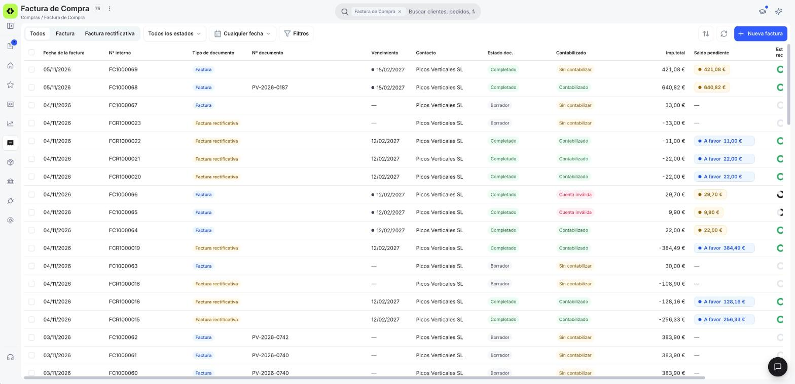
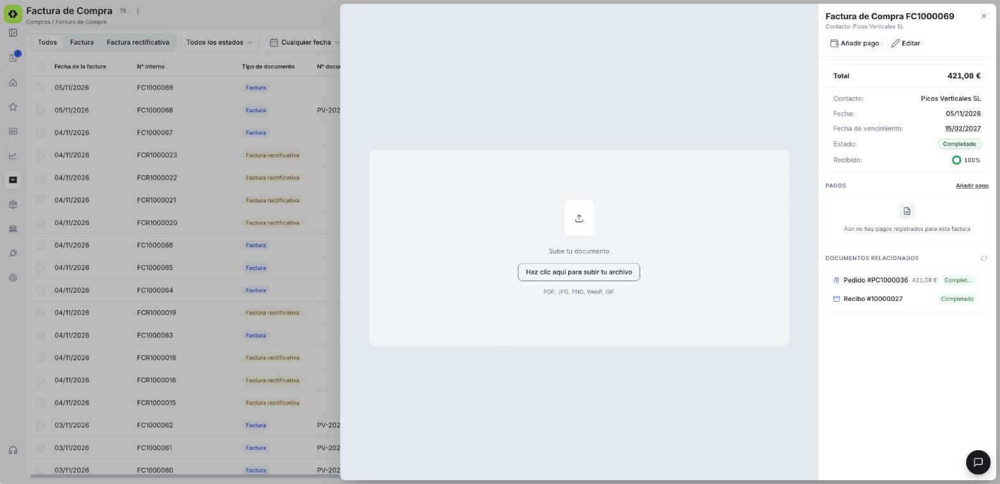
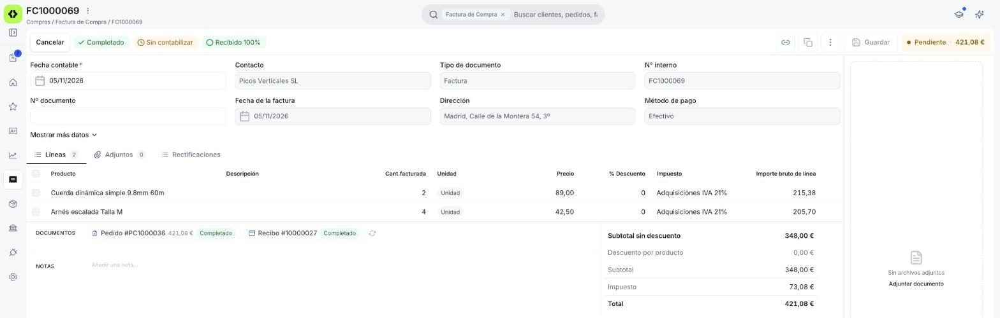
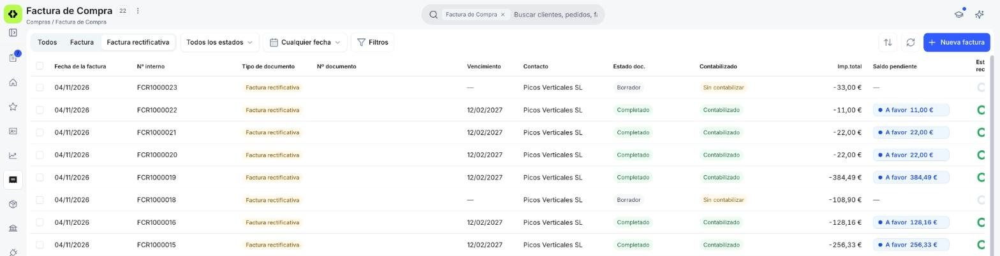

# Gestionar tus facturas de compra

Una vez que tienes facturas de compra cargadas, vas a necesitar consultarlas, editarlas o revisar su estado de pago. Este artículo repasa la ventana de **[Compras > Factura](https://app.etendo.ai/purchase-invoice){target="_blank"}** — la vista lista, la vista detalle y la vista formulario. Si todavía no has creado ninguna, empieza por [Registrar una factura de compra](../crear-una-factura-de-compra/crear-una-factura-de-compra.md).

## Vista Lista

<figure markdown="span">
  
  <figcaption>Vista lista de Factura de compra con las columnas Fecha de la factura, Nº interno, Tipo de documento, Nº documento, Vencimiento, Contacto, Estado doc., Contabilizado, Imp.total y Saldo pendiente (etiquetas ámbar, • A favor y —).</figcaption>
</figure>

La vista lista muestra todas las facturas con las siguientes columnas:

- **Fecha de la factura**.
- **Nº interno** — la numeración propia de Etendo para la factura (por ejemplo, `FC1000009`, o `FCR1000002` para una Factura Rectificativa). Es distinta del Nº documento del proveedor.
- **Tipo de documento**.
- **Nº documento** — el número que el proveedor puso en su factura.
- **Vencimiento** — ver el detalle de colores más abajo.
- **Contacto**.
- **Estado doc.** — el estado del documento (Borrador, Completado, etc.).
- **Contabilizado** — indica si el documento ya generó su asiento contable (el registro que refleja la operación en la contabilidad de la empresa). Ver los valores posibles más abajo.
- **Imp.total** — abreviatura de "Importe total": el importe total de la factura.
- **Saldo pendiente** — lo que queda por pagar de la factura. Ver los valores posibles más abajo.
- **Estado de recepción** — muestra, en porcentaje de 0% a 100%, cuánto de lo facturado ya fue recibido y registrado contra un albarán (el documento que certifica la entrega física de la mercancía). Si falta mercancía por recibir, puedes crear el albarán desde la propia factura con **Gestionar recepción**.

La barra superior incluye pestañas para filtrar por tipo de documento: **Todos**, **Factura** y **Factura rectificativa**. Los selectores de **estado del documento** y **fecha** permiten filtrar la lista, y **Filtros** habilita condiciones adicionales. Para crear una factura nueva usa **+ Nueva factura**.

La columna **Vencimiento** muestra un punto de color junto a la fecha según el estado de pago:

- Verde — la factura está pagada.
- Rojo — venció y sigue pendiente.
- Ámbar — el vencimiento está próximo.
- Gris — queda pendiente, pero el vencimiento todavía está lejos.

La columna **Saldo pendiente** muestra:

- 121,00 € — en una etiqueta ámbar, el importe que queda por pagar de una factura pendiente.
- • A favor 28,40 € — en una etiqueta azul, el importe a tu favor de una Factura Rectificativa (consulta [Facturas Rectificativas](#facturas-rectificativas)).
- `—` — en las facturas en Borrador, que todavía no generan saldo.

La columna **Contabilizado** muestra uno de estos valores:

- Contabilizado — la factura ya está registrada en la contabilidad.
- Sin contabilizar — la factura todavía no está registrada en la contabilidad.
- Cuenta inválida — en rojo.

## Vista Detalle

<figure markdown="span">
  
  <figcaption>Vista detalle de una factura de compra completada, con el bloque de datos, el indicador Recibido y las secciones PAGOS y DOCUMENTOS RELACIONADOS.</figcaption>
</figure>

Al hacer clic sobre una factura existente en la lista se abre el panel de detalle, con las acciones **Añadir pago** y **Editar** en la cabecera. El panel muestra:

- Si se adjuntó el documento original de la factura del proveedor (por ejemplo, el PDF que te envió), se previsualiza a la izquierda del panel.
- **Total**, **Contacto**, **Fecha**, **Fecha de vencimiento**, **Estado** y **Recibido**, este último con el porcentaje de lo facturado que ya recibiste. Como comportamiento general del producto, si la factura está en una moneda distinta a la de tu empresa, el Total se muestra en la moneda de tu empresa, con el importe original en la moneda del documento justo debajo entre paréntesis.
- Sección **PAGOS** — con el indicador **Pagada** cuando corresponde, el historial de pagos registrados (número, método, importe y su propio estado) y el enlace **Añadir pago**. Si todavía no registraste ninguno, muestra "Aún no hay pagos registrados para esta factura". Ver [Añadir pagos a tu factura de compra](../anadir-pagos-a-tu-factura-de-compra/anadir-pagos-a-tu-factura-de-compra.md).
- Sección **DOCUMENTOS RELACIONADOS** — con el pedido y/o albarán de origen, cuando la factura se generó a partir de alguno de ellos.

## Vista Formulario

<figure markdown="span">
  
  <figcaption>Formulario de una factura completada: etiquetas Completado, Sin contabilizar y Recibido 100%, indicador Pendiente con el importe y panel de adjuntos a la derecha.</figcaption>
</figure>

Al hacer clic en **Editar** se abre el formulario completo. Para el detalle de cada campo de la cabecera y de las líneas, consulta [Registrar una factura de compra](../crear-una-factura-de-compra/crear-una-factura-de-compra.md), que recorre el mismo formulario.

En una factura Completada, el formulario muestra:

- **Barra superior, a la izquierda** — **Cancelar** y las etiquetas de estado: **Completado**, el estado de contabilización (por ejemplo, **Sin contabilizar**) y el progreso de recepción (por ejemplo, **Recibido 100%**).
- **Barra superior, a la derecha** — los iconos **Copiar enlace**, **Clonar** y el menú ⋮ (con **Reactivar** y, según el caso, **Contabilizar** o **Descontabilizar**), el botón **Guardar** deshabilitado y el indicador de pago (por ejemplo, **Pendiente · 121,00 €**).
- **Panel derecho de adjuntos** — si la factura no tiene archivos, muestra "Sin archivos adjuntos" y el enlace **Adjuntar documento**.

## Estados del Documento

| Estado | Descripción |
|---|---|
| Borrador | En preparación. El documento es completamente editable. |
| Completado | Confirmada. Ya no es editable. Queda pendiente de pago al proveedor hasta registrar los pagos correspondientes. |

!!! warning "La factura no se puede editar tras confirmar"
    Una vez confirmada, la factura queda bloqueada. Verifica los importes, el contacto y las condiciones de pago antes de confirmar. Para corregir errores en una factura completada, puedes devolverla a Borrador con **Reactivar** si todavía cumple las condiciones (ver [Acciones disponibles](#acciones-disponibles)); si no, registra la Factura Rectificativa que te envíe el proveedor — ver [Registrar una factura rectificativa](../registrar-una-factura-rectificativa/registrar-una-factura-rectificativa.md).

En estado Completado, la barra superior del formulario muestra además un indicador con el importe: **Pendiente ·** *[importe]* en ámbar mientras queda saldo por pagar, o **Pagado ·** *[importe]* en verde una vez saldada. A diferencia del punto de color de la Vista Lista, este indicador no distingue si la factura está vencida — se mantiene en ámbar tanto si el vencimiento es próximo como si ya pasó.

## Acciones Disponibles

| Acción | Descripción | Estado |
| :--- | :--- | :--- |
| **Cancelar** | Cierra el formulario y vuelve a la lista; en Borrador, descarta los cambios no guardados. | Borrador y Completado |
| **Guardar** | Guarda el documento sin cambiar su estado. En Completado aparece deshabilitado. | Solo en Borrador |
| **Confirmar** | Confirma la factura y la pasa a estado Completado. | Solo en Borrador |
| **Copiar enlace** | Copia la dirección de la factura para compartirla con otra persona de tu equipo. | Completado |
| **Clonar** | Crea un nuevo borrador con el mismo proveedor, líneas y condiciones. | Borrador y Completado |
| **Eliminar** | Elimina el documento con confirmación previa. | Solo en Borrador |
| **Reactivar** | Disponible en el menú ⋮. Vuelve la factura a estado Borrador para poder corregirla. Solo disponible si la factura no tiene pagos asociados, no se ha enviado a Hacienda (SII o VERI*FACTU) y, si incluye mercancía, esta aún no se ha recibido. Si ya no puedes reactivarla, corrígela con una rectificativa: consulta [Registrar una factura rectificativa](../registrar-una-factura-rectificativa/registrar-una-factura-rectificativa.md). | Solo en Completado |
| **Contabilizar** | Disponible en el menú ⋮. Registra la factura en la contabilidad de la empresa. | Completado y Sin contabilizar |
| **Descontabilizar** | Disponible en el menú ⋮. Revierte la contabilización de la factura. | Completado y Contabilizado |
| **Añadir pago** | Disponible en la vista detalle. Registra un pago de la factura — ver [Añadir pagos a tu factura de compra](../anadir-pagos-a-tu-factura-de-compra/anadir-pagos-a-tu-factura-de-compra.md). | Solo en Completado |
| **Gestionar recepción** | Crea un [albarán de compra](../crear-y-gestionar-albaranes-de-compra/crear-y-gestionar-albaranes-de-compra.md) en Borrador con las cantidades de la factura que faltan por recibir. | Completado, con mercancía pendiente de recibir |

## Facturas Rectificativas

<figure markdown="span">
  
  <figcaption>Vista lista filtrada por la pestaña Factura rectificativa: la columna Saldo pendiente muestra la etiqueta azul • A favor con el importe, en vez de un importe pendiente.</figcaption>
</figure>

Una Factura Rectificativa se gestiona desde la misma ventana y vista lista de **[Compras > Factura](https://app.etendo.ai/purchase-invoice){target="_blank"}**, filtrando por la pestaña **Factura rectificativa**. Se identifica con su propio **Nº interno** (por ejemplo, `FCR1000003`). Si la rectificativa baja el importe, al confirmarla la columna **Saldo pendiente** muestra la etiqueta azul **• A favor** *[importe]* (por ejemplo, **• A favor 28,40 €**) en vez de un importe pendiente; si lo sube, muestra el importe pendiente de pago, como cualquier factura. Ese saldo a favor es un importe que el proveedor te debe en general, no un descuento aplicado automáticamente a una factura puntual — se concilia por **Contacto**, no seleccionando una factura origen específica. En la práctica, esto significa que ese saldo queda disponible para aplicarlo al pagar cualquier factura de ese proveedor, también la original si aún no la has pagado.

El saldo a tu favor puede ser menor que el importe de la Factura Rectificativa cuando una parte ya se consumió. Por ejemplo, una Factura Rectificativa de `-85,00 €` puede mostrar **• A favor 16,00 €**.

## Artículos Relacionados

- [Registrar una factura de compra](../crear-una-factura-de-compra/crear-una-factura-de-compra.md)
- [Añadir pagos a tu factura de compra](../anadir-pagos-a-tu-factura-de-compra/anadir-pagos-a-tu-factura-de-compra.md)
- [Crear una devolución de compra](../crear-una-devolucion-de-compra/crear-una-devolucion-de-compra.md)

---
Esta obra está bajo la licencia :material-creative-commons: :fontawesome-brands-creative-commons-by: :fontawesome-brands-creative-commons-sa: [CC BY-SA 2.5 ES](https://creativecommons.org/licenses/by-sa/2.5/es/){target="_blank"} de [Futit Services S.L](https://etendo.software){target="_blank"}.
