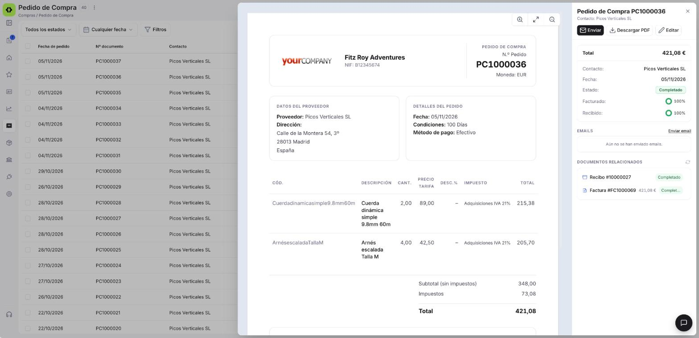
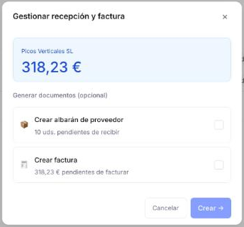

# Gestionar tus pedidos de compra

Una vez que tienes pedidos de compra cargados, vas a necesitar consultarlos, editarlos o generar los documentos que originan. Este artículo repasa la ventana de **[Compras > Pedido de Compra](https://app.etendo.ai/purchase-order){target="_blank"}** — la vista lista, la vista detalle y las acciones disponibles. Si todavía no has creado ninguno, empieza por [Crear un pedido de compra](../crear-un-pedido-de-compra/crear-un-pedido-de-compra.md).

## Vista Lista

<figure markdown="span">
  
  <figcaption>Vista lista del Pedido de compra con columnas de estado, progreso de facturación y recepción.</figcaption>
</figure>

La vista lista muestra todos los pedidos con las columnas **Fecha de pedido**, **Nº documento**, **Contacto**, **Estado doc.**, **Imp. total**, **Estado de facturación** y **Estado de recepción**.

**Estado de facturación** y **Estado de recepción** indican qué parte del pedido ya se facturó o se recibió. Ambas columnas muestran un indicador circular con el porcentaje.

Los selectores de **estado del documento** y **fecha de pedido**, en la barra superior, permiten filtrar la lista, y **Filtros** habilita condiciones adicionales. El botón **+ Nuevo pedido**, en la esquina superior derecha, crea un pedido nuevo.

---

## Vista Detalle

<figure markdown="span">
  
  <figcaption>Vista detalle con previsualización del PDF y panel lateral con los indicadores Facturado y Recibido, la sección EMAILS y los DOCUMENTOS RELACIONADOS.</figcaption>
</figure>

Al hacer clic sobre un pedido existente en la lista se abre la vista detalle. El centro muestra una previsualización del PDF y el panel derecho muestra la información clave: total, contacto, fecha, estado, y los indicadores **Facturado** y **Recibido**.

Desde este panel puedes:

- **Enviar** — abre el panel de envío por email al proveedor. El destinatario y el asunto vienen precompletados con los datos del proveedor; si no tiene un email registrado, debes escribirlo manualmente antes de poder enviar. Desde el mismo panel también puedes usar **Descargar PDF** si prefieres enviarlo por otro medio o imprimirlo.
- **Descargar PDF** — descarga el pedido en formato PDF.
- **Editar** — abre el formulario completo. En Borrador es editable; en Completado se abre en solo lectura, ya que el pedido queda bloqueado tras confirmar (consulta [Estados del Documento](#estados-del-documento)). Consulta [Crear un pedido de compra](../crear-un-pedido-de-compra/crear-un-pedido-de-compra.md) para el detalle de estos campos.

El panel incluye además dos secciones:

- **EMAILS** — historial de correos enviados al proveedor, con el enlace **Enviar email** para enviar uno nuevo.
- **DOCUMENTOS RELACIONADOS** — los albaranes de compra (recepciones) y facturas generados a partir del pedido, incluidas las Facturas Rectificativas, cada uno con su número, importe cuando corresponde y estado. Así ves de un vistazo qué se recibió y qué se facturó a partir de este pedido.

---

## Estados del Documento

| Estado | Descripción |
|---|---|
| Borrador | En preparación. El documento es completamente editable. |
| Completado | Confirmado. Ya no es editable. Se puede gestionar la recepción y la factura. |

!!! warning "El pedido no se puede editar tras confirmar"
    Una vez confirmado, el pedido queda bloqueado. Verifica las líneas, cantidades y precios antes de confirmar.

En un pedido Completado, el formulario se abre en solo lectura y cambia un poco su diseño:

- La barra superior muestra, junto a **Cancelar**, la etiqueta **Completado** y dos etiquetas de progreso: **Recibido** y **Facturado**, cada una con su porcentaje (por ejemplo, **Recibido 100%**). Son los mismos indicadores que ves en el panel de detalle.
- Los campos **Moneda** y **Tarifa** pasan a estar tras el enlace **Mostrar más datos**.

---

## Acciones Disponibles

Estas son las acciones disponibles en la barra superior del formulario y en la vista detalle:

| Acción | Descripción | Estado |
| :--- | :--- | :--- |
| **Cancelar** | Cierra el formulario sin guardar los últimos cambios. El pedido no se elimina; sigue disponible en la lista en su último estado guardado. | Borrador y Completado |
| **Guardar** | Guarda el documento sin cambiar su estado. | Solo en Borrador |
| **Confirmar** | Abre el popup **Confirmar pedido** y pasa el pedido a [estado Completado](#estados-del-documento). Está deshabilitado mientras el pedido no tenga líneas. Consulta [Crear un pedido de compra](../crear-un-pedido-de-compra/crear-un-pedido-de-compra.md#confirmar-el-pedido). | Solo en Borrador |
| **Eliminar** | Icono de papelera. Elimina el documento con confirmación previa. | Solo en Borrador |
| **Copiar enlace** | Copia la dirección del pedido para compartirla con otra persona de tu equipo. | Borrador y Completado |
| **Clonar** | Crea un nuevo borrador con el mismo proveedor, líneas y condiciones. | Borrador y Completado |
| **Imprimir** | Imprime el pedido. | Solo en Completado |
| **Enviar / Descargar** | Disponible en la barra superior del formulario. Abre el envío por email al proveedor o la descarga del pedido en PDF. | Solo en Completado |
| **Enviar** | Disponible en la vista detalle. Abre el envío por email al proveedor. | Solo en Completado |
| **Descargar PDF** | Disponible en la vista detalle. Descarga el pedido en formato PDF. | Completado (deshabilitado en Borrador) |
| **Editar** | Disponible en la vista detalle. Abre el formulario del pedido. | Borrador y Completado |
| **Gestionar recepción y factura** / **Gestionar factura** | Botón principal que abre una ventana para crear los documentos pendientes. Su nombre depende de lo que quede pendiente (consulta [Gestionar los documentos pendientes](#gestionar-los-documentos-pendientes)). | Completado, mientras quede algo pendiente |

### Gestionar los documentos pendientes

<figure markdown="span">
  
  <figcaption>Ventana Gestionar recepción y factura de un pedido con recepción y factura pendientes: muestra las unidades pendientes de recibir y el importe pendiente de facturar.</figcaption>
</figure>

En estado Completado, el botón principal de la barra superior te permite generar los documentos que quedan pendientes del pedido. El nombre del botón depende de lo que quede pendiente:

| Qué queda pendiente | Botón |
| :--- | :--- |
| Recepción y factura | **Gestionar recepción y factura** |
| Solo la factura (recepción al 100 %) | **Gestionar factura** |

En los dos casos, el botón abre una ventana que muestra el proveedor y el importe del pedido. Cuando quedan pendientes la recepción y la factura, la sección **Generar documentos (opcional)** ofrece dos casillas:

- **Crear albarán de proveedor** — genera un [albarán de compra](../crear-y-gestionar-albaranes-de-compra/crear-y-gestionar-albaranes-de-compra.md) en Borrador con las unidades pendientes de recibir. El popup indica la cantidad pendiente (por ejemplo, *4 uds. pendientes de recibir*).
- **Crear factura** — crea y confirma una [factura de compra](../crear-una-factura-de-compra/crear-una-factura-de-compra.md) por el importe pendiente de facturar (por ejemplo, *44,00 € pendientes de facturar*). La factura queda directamente en estado Completado.

Cuando solo queda pendiente la factura, el popup ofrece únicamente la opción **Crear factura**, en la sección **Documento a generar**, junto con un resumen de lo ya facturado y lo pendiente.

Marca lo que necesites y pulsa **Crear →**, o **Cancelar** para cerrar el popup sin generar nada. Tras crear, un popup de resultado (**Albarán creado** o **Factura creada**) te confirma que se ha generado el documento: pulsa **Ver albarán** o **Ver factura** para abrirlo, o **Cerrar** para seguir en el pedido.

!!! info "También puedes generarlos al confirmar"
    Las mismas opciones **Crear albarán de proveedor** y **Crear factura** aparecen en el popup **Confirmar pedido**, al confirmar un pedido nuevo. El botón principal del pedido Completado te permite generarlos más adelante si en ese momento no lo hiciste.

!!! info "Cuándo desaparece el botón"
    Cuando los indicadores **Recibido** y **Facturado** alcanzan el 100 %, el botón desaparece porque no quedan unidades ni importes pendientes.

!!! tip "Datos heredados en los documentos generados"
    El albarán y la factura creados desde el pedido heredan el contacto, la dirección, las condiciones de pago y las líneas pendientes.

---

## Artículos Relacionados

- [Crear un pedido de compra](../crear-un-pedido-de-compra/crear-un-pedido-de-compra.md)
- [Gestionar tus facturas de compra](../gestionar-tus-facturas-de-compra/gestionar-tus-facturas-de-compra.md)
- [Contactos](../../../comercial/contactos/que-es-la-seccion-contactos/que-es-la-seccion-contactos.md)

---
Esta obra está bajo la licencia :material-creative-commons: :fontawesome-brands-creative-commons-by: :fontawesome-brands-creative-commons-sa: [CC BY-SA 2.5 ES](https://creativecommons.org/licenses/by-sa/2.5/es/){target="_blank"} de [Futit Services S.L](https://etendo.software){target="_blank"}.
