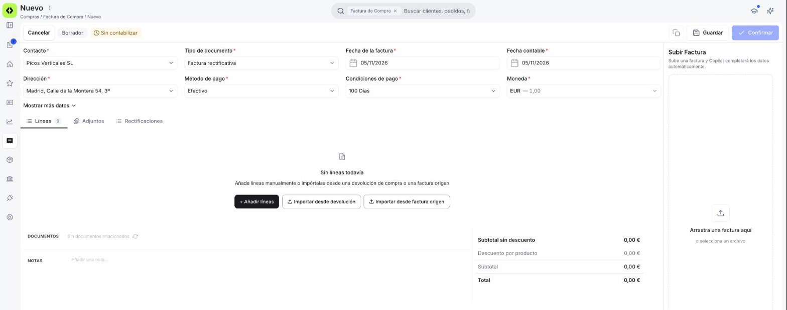

# Registrar una factura rectificativa

Cuando un proveedor te corrige una factura, ya sea por un precio mal facturado, un descuento posterior o una devolución de mercancía (en este caso, tienes [dos formas de registrar la rectificativa](#si-hay-devolucion-de-mercancia)), registra su factura rectificativa para saber cuánto menos le tienes que pagar, cuánto te debe o cuánto más le debes.

## Antes de empezar: comprueba si puedes reactivar la factura

Si el error es tuyo al registrar la factura (por ejemplo, has tecleado mal un importe), a veces no necesitas rectificativa. Puedes reactivarla con **Reactivar**, en el menú ⋮, si se cumplen estas condiciones:

- **La factura no tiene pagos registrados.**
- **Todavía no se ha enviado a Hacienda** por el SII, el sistema con el que Hacienda recibe tus facturas.
- **Si la factura incluye mercancía, todavía no la has recibido** del proveedor.

Una factura solo de servicios, sin mercancía, se puede reactivar si cumple las dos primeras condiciones. La factura vuelve a Borrador, la corriges y la confirmas de nuevo con el mismo número.

Tienes el detalle de **Reactivar** en [Gestionar tus facturas de compra](../gestionar-tus-facturas-de-compra/gestionar-tus-facturas-de-compra.md#acciones-disponibles).

Si el proveedor te ha enviado una factura rectificativa, regístrala siempre, aunque la factura original se pudiera reactivar. La original no desaparece y conserva su número.

## Registrar manualmente la rectificativa

<figure markdown="span">
  
  <figcaption>Factura rectificativa de compra: los mismos datos que una factura, con Tipo de documento en Factura rectificativa y las opciones + Añadir líneas, Importar desde devolución e Importar desde factura origen.</figcaption>
</figure>

Sigue estos pasos para registrar la rectificativa desde la factura. Sirven para cualquier motivo: un precio mal facturado, un descuento, una bonificación del proveedor o una devolución de mercancía.

1. Entra en **[Compras > Factura](https://app.etendo.ai/purchase-invoice){target="_blank"}** y pulsa **+ Nueva factura**.
2. En **Tipo de documento**, elige *Factura rectificativa*. Una vez guardada, este dato ya no se puede cambiar.
3. Elige el proveedor en **Contacto** y rellena el resto de datos igual que en una [factura de compra](../crear-una-factura-de-compra/crear-una-factura-de-compra.md): **Dirección**, **Método de pago**, **Condiciones de pago**, **Moneda** y **Tarifa**.
4. En la pestaña **Rectificaciones**, pulsa **+ Añadir rectificación** y elige la factura o facturas que corrige.
5. Añade las líneas de la corrección de una de estas formas:
    - A mano, con **+ Añadir líneas**.
    - Con **Importar desde devolución**, que trae las líneas de una devolución al proveedor ya confirmada, cuando la rectificativa corresponde a una devolución.
    - Con **Importar desde factura origen**, que trae las líneas de la factura que corrige. Es lo más cómodo para corregir un precio o aplicar un descuento sobre lo ya facturado.

    No puedes importar líneas desde un pedido ni desde un albarán de compra.
6. Revisa los importes y pulsa **Confirmar**.

!!! warning "Indica siempre qué factura corriges"
    Si no indicas en **Rectificaciones** qué factura corrige, la rectificativa no se puede confirmar.

## Si hay devolución de mercancía

Si devuelves productos al proveedor, tienes dos formas de registrar la rectificativa:

- **Al confirmar el albarán de devolución.** La rectificativa se crea y se confirma en el mismo paso, con la factura que corrige ya elegida. Consulta [Confirmar la devolución](../crear-una-devolucion-de-compra/crear-una-devolucion-de-compra.md#confirmar-la-devolucion).
- **Desde la factura**, siguiendo los [pasos de arriba](#registrar-la-rectificativa) e importando las líneas de la devolución ya confirmada.

## Qué pasa después

La rectificativa no sustituye a la factura original: solo recoge la diferencia, en más o en menos. Lo que pasa después depende de si esa diferencia baja o sube el importe:

- **Si lo baja** (una devolución, un descuento o un precio facturado de más) — la rectificativa queda como saldo a tu favor con ese proveedor, es decir, dinero que te debe. Ese saldo no se descuenta automáticamente de una factura concreta. Lo aplicas tú al pagar cualquier factura de ese proveedor, también la original si aún no la has pagado. Consulta [Aplicar saldo a favor y crédito disponible](../anadir-pagos-a-tu-factura-de-compra/anadir-pagos-a-tu-factura-de-compra.md#aplicar-saldo-a-favor-y-credito-disponible).

    En la lista de facturas la verás con la etiqueta **• A favor** en la columna **Saldo pendiente**.

- **Si lo sube** (un precio facturado de menos) — le debes la diferencia al proveedor. Queda pendiente de pago, como en cualquier factura.

!!! info "Para tu asesor"
    - *Fecha*: la fecha contable de la factura rectificativa tiene que caer en un periodo contable abierto.
    - *Tipo*: es una rectificativa por diferencias. Etendo no admite rectificativas por sustitución.
    - *Numeración*: las rectificativas de compra tienen su propia numeración interna, por ejemplo `FCR1000003`.
    - *Conciliación*: cuando la rectificativa deja un saldo a favor, se concilia por contacto, no contra la factura que corrige. Puede ser menor que el importe de la rectificativa si una parte ya se ha aplicado.

## Artículos Relacionados

- [Crear una devolución de compra](../crear-una-devolucion-de-compra/crear-una-devolucion-de-compra.md)
- [Gestionar tus facturas de compra](../gestionar-tus-facturas-de-compra/gestionar-tus-facturas-de-compra.md)
- [Registrar una factura de compra](../crear-una-factura-de-compra/crear-una-factura-de-compra.md)

---
Esta obra está bajo la licencia :material-creative-commons: :fontawesome-brands-creative-commons-by: :fontawesome-brands-creative-commons-sa: [CC BY-SA 2.5 ES](https://creativecommons.org/licenses/by-sa/2.5/es/){target="_blank"} de [Futit Services S.L](https://etendo.software){target="_blank"}.
