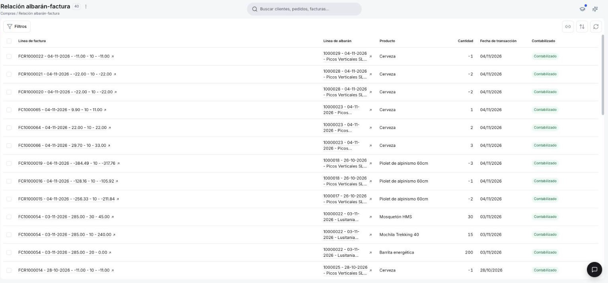

# Relación albarán-factura

La ventana **[Compras > Relación albarán-factura](https://app.etendo.ai/matched-purchase-invoices){target="_blank"}** te muestra qué línea de cada factura de compra se emparejó con qué línea de albarán (recepción o devolución), para que compruebes que lo facturado por el proveedor coincide con lo que recibiste o devolviste.

!!! info "Ventana de solo consulta"
    En esta ventana no se crean ni se editan registros: refleja lo que ya trabajaste en tus [albaranes de compra](../crear-y-gestionar-albaranes-de-compra/crear-y-gestionar-albaranes-de-compra.md) y tus [facturas de compra](../gestionar-tus-facturas-de-compra/gestionar-tus-facturas-de-compra.md).

## Vista Lista

<figure markdown="span">
  
  <figcaption>Vista lista de Relación albarán-factura, con cada línea de factura emparejada con su línea de albarán, la cantidad y el estado de contabilización.</figcaption>
</figure>

Cada fila de la lista es un emparejamiento entre una línea de factura y una línea de albarán. La lista muestra estas columnas:

| Columna | Qué muestra |
| :--- | :--- |
| **Línea de factura** | La línea de la factura de compra, con el número de la factura, su fecha, el importe y otros datos de la línea (por ejemplo, `FC1000009 - 14-10-2026 - …`). El enlace ↗ abre la factura. |
| **Línea de albarán** | La línea del albarán con la que se emparejó, identificada por el número de albarán y su fecha (por ejemplo, `10000004 - 14-10-2026 - …`). Puede ser un albarán de compra (recepción) o un albarán de devolución. Tiene un enlace ↗. |
| **Producto** | El producto de la línea. |
| **Cantidad** | Las unidades emparejadas. En las Facturas Rectificativas (devoluciones) la cantidad aparece en negativo, por ejemplo `-2`. |
| **Fecha de transacción** | Fecha de la transacción. |
| **Contabilizado** | Indica si el emparejamiento ya está registrado en la contabilidad de la empresa: **Contabilizado** o **Sin contabilizar**. |

El botón **Filtros** te permite añadir condiciones para acotar la lista. A la derecha de la barra tienes los iconos para copiar el enlace de la vista, ordenar y refrescar la lista.

## Vista Detalle

Para abrir un documento, usa el enlace ↗ de la columna **Línea de factura**. Consulta [Gestionar tus facturas de compra](../gestionar-tus-facturas-de-compra/gestionar-tus-facturas-de-compra.md) y [Crear y gestionar albaranes de compra](../crear-y-gestionar-albaranes-de-compra/crear-y-gestionar-albaranes-de-compra.md#gestionar-albaranes) para el detalle de cada documento.

## Estados del Documento

Los emparejamientos no tienen estado de documento propio (no hay Borrador ni Completado). Lo único que cambia es su estado de contabilización:

| Estado | Descripción |
|---|---|
| Contabilizado | El emparejamiento ya está registrado en la contabilidad. |
| Sin contabilizar | El emparejamiento todavía no está registrado en la contabilidad. |

## Acciones Disponibles

| Acción | Descripción | Estado |
| :--- | :--- | :--- |
| **Filtros** | Disponible en la barra superior. Añade condiciones para acotar la lista. | Todos los registros |
| **↗ (abrir factura)** | Disponible en la columna Línea de factura. Abre la factura sin abrir una ventana nueva del navegador. | Todos los registros |

## Artículos Relacionados

- [Crear y gestionar albaranes de compra](../crear-y-gestionar-albaranes-de-compra/crear-y-gestionar-albaranes-de-compra.md)
- [Gestionar tus facturas de compra](../gestionar-tus-facturas-de-compra/gestionar-tus-facturas-de-compra.md)
- [Gestionar tus albaranes de devolución](../gestionar-tus-albaranes-de-devolucion/gestionar-tus-albaranes-de-devolucion.md)

---
Esta obra está bajo la licencia :material-creative-commons: :fontawesome-brands-creative-commons-by: :fontawesome-brands-creative-commons-sa: [CC BY-SA 2.5 ES](https://creativecommons.org/licenses/by-sa/2.5/es/){target="_blank"} de [Futit Services S.L](https://etendo.software){target="_blank"}.
