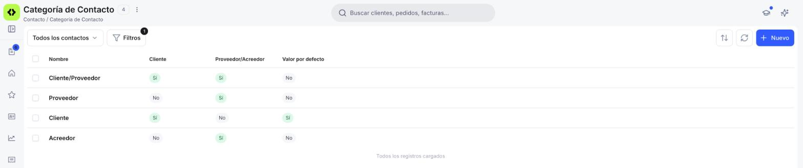
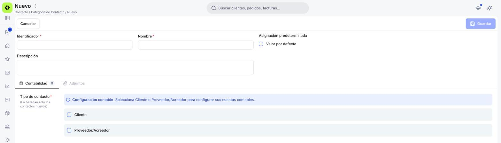
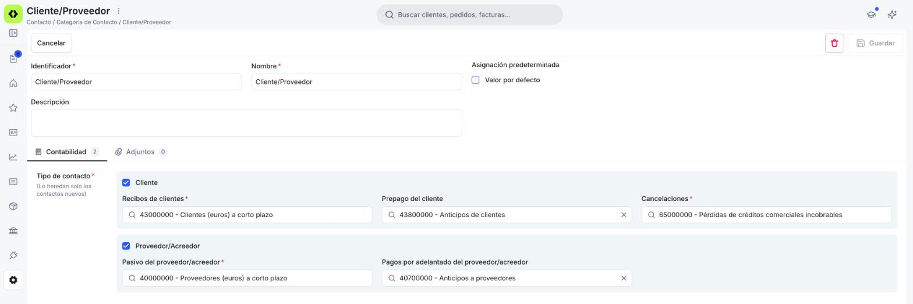

# Cómo configurar las categorías de contacto

Cada contacto que creas pertenece a una **categoría de contacto**. La categoría decide dos cosas: si ese contacto es cliente, proveedor o ambos, y en qué cuentas contables se registra lo que le vendes o le compras. Etendo trae cuatro categorías listas para usar (*Cliente*, *Proveedor*, *Cliente/Proveedor* y *Acreedor*). Si necesitas agrupar a tus contactos de otra forma, puedes crear las tuyas desde la ventana **Categoría de Contacto**.

## 1. Accede a la Ventana Categoría de Contacto

1. En el menú lateral, dentro de la sección **Sistema**, haz clic en **Configuración**.
2. Selecciona **[Categoría de Contacto](https://app.etendo.ai/business-partner-category){target="_blank"}**.

<figure markdown="span">
  
  <figcaption>Vista lista de Categoría de Contacto, con las cuatro categorías estándar.</figcaption>
</figure>

La vista lista muestra, para cada categoría, si sus contactos son **Cliente**, **Proveedor/Acreedor** o ambos, y si es el **Valor por defecto**. Con el selector **Todos los contactos** puedes ver solo las categorías de clientes o solo las de proveedores y acreedores.

## 2. Crea una Categoría

1. Haz clic en **Nuevo**.
2. Completa los datos generales:
    - **Identificador** *(obligatorio)* — código corto con el que reconoces la categoría.
    - **Nombre** *(obligatorio)* — nombre que ves al elegir la categoría en un contacto.
    - **Descripción** — opcional, para explicar cuándo usarla.
    - **Valor por defecto** — márcalo si quieres que esta categoría aparezca ya elegida al crear un contacto nuevo.
3. En la pestaña **Contabilidad**, elige el **Tipo de contacto** *(obligatorio)*: marca **Cliente**, **Proveedor/Acreedor** o las dos casillas si los contactos de esta categoría te compran y te venden.
4. Haz clic en **Guardar**.

<figure markdown="span">
  
  <figcaption>Formulario de una nueva categoría, antes de elegir el Tipo de contacto.</figcaption>
</figure>

## 3. Revisa sus Cuentas Contables

Al guardar la categoría, Etendo le asigna automáticamente las cuentas contables por defecto de cada tipo que marcaste. No tienes que configurar nada para empezar a usarla, pero puedes cambiar cualquiera de esas cuentas si tu asesor te lo pide.

<figure markdown="span">
  
  <figcaption>Cuentas contables de la categoría Cliente/Proveedor.</figcaption>
</figure>

Las cuentas se agrupan por tipo de contacto:

| Tipo | Campo | Para qué se usa |
| --- | --- | --- |
| **Cliente** | **Recibos de clientes** *(obligatorio)* | Lo que tus clientes te deben por las facturas que les emites. |
| **Cliente** | **Prepago del cliente** | Los anticipos que un cliente te paga antes de recibir la factura. |
| **Cliente** | **Cancelaciones** *(obligatorio)* | Las deudas de clientes que das por perdidas porque no las vas a cobrar. |
| **Proveedor/Acreedor** | **Pasivo del proveedor/acreedor** *(obligatorio)* | Lo que tú debes a tus proveedores por las facturas que te emiten. |
| **Proveedor/Acreedor** | **Pagos por adelantado del proveedor/acreedor** | Los anticipos que pagas a un proveedor antes de recibir su factura. |

Para cambiar una cuenta, haz clic en el campo, busca la nueva cuenta por su número o su nombre, selecciónala y haz clic en **Guardar**.

!!! warning "Los cambios solo afectan a los contactos nuevos"
    Cada contacto guarda sus propias cuentas contables, en las solapas **Contabilidad cliente** y **Contabilidad proveedor** de su ficha. Cuando le asignas una categoría, el contacto toma las cuentas que esa categoría tiene en ese momento. Por eso, si después cambias una cuenta de la categoría, el cambio solo se aplica a los contactos que crees a partir de entonces: los contactos que ya existían conservan las cuentas que tenían. Para ver qué cuentas tiene un contacto concreto, revisa esas dos solapas en su ficha.

!!! info "Para tu asesor"
    Las cuentas que Etendo propone por defecto salen del plan contable de tu organización. Por ejemplo, en *Cliente/Proveedor*: **43000000** (clientes), **43800000** (anticipos de clientes), **65000000** (pérdidas de créditos comerciales incobrables), **40000000** (proveedores) y **40700000** (anticipos a proveedores). En *Acreedor*, el pasivo va a **41000000** (acreedores por prestaciones de servicios) y los anticipos a **41700000**.

## 4. Asigna la Categoría a tus Contactos

Con la categoría guardada, ya puedes elegirla en el campo **Categoría de contacto** al [crear un contacto](../../../comercial/contactos/como-crear-un-contacto/como-crear-un-contacto.md) o al [importar contactos](../../../comercial/contactos/importar-contactos/importar-contactos.md). Según el tipo que tenga la categoría, el contacto muestra las preferencias de facturación de cliente, de proveedor o de ambos en su solapa **Financiero**.

## Artículos Relacionados

- [Cómo crear un contacto](../../../comercial/contactos/como-crear-un-contacto/como-crear-un-contacto.md) — donde eliges la categoría de cada contacto.
- [¿Qué es la sección Contactos?](../../../comercial/contactos/que-es-la-seccion-contactos/que-es-la-seccion-contactos.md) — cómo se relacionan los roles de cliente y proveedor.
- [Gestionar tus contactos](../../../comercial/contactos/gestionar-tus-contactos/gestionar-tus-contactos.md) — cómo cambiar la categoría de un contacto que ya existe.

---
Esta obra está bajo la licencia :material-creative-commons: :fontawesome-brands-creative-commons-by: :fontawesome-brands-creative-commons-sa: [CC BY-SA 2.5 ES](https://creativecommons.org/licenses/by-sa/2.5/es/){target="_blank"} de [Futit Services S.L](https://etendo.software){target="_blank"}.
