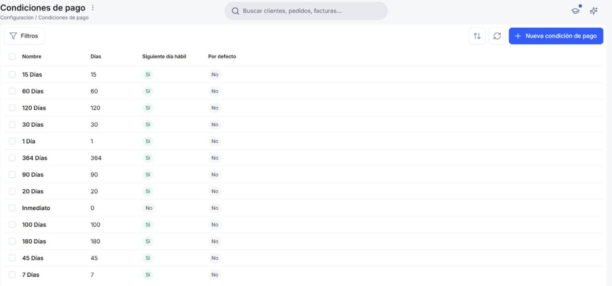
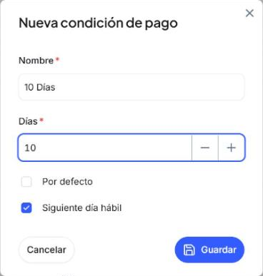
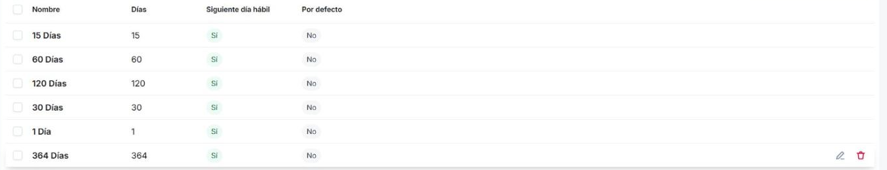

# Cómo configurar las condiciones de pago

Las **condiciones de pago** son el plazo que das a tus clientes para pagarte, o el que te dan tus proveedores, y con ellas Etendo calcula cuándo vence cada factura.

- Para crear, editar o eliminar condiciones de pago necesitas el rol **Administrador** o **Finanzas**. Con **Ventas** o **Compras** solo puedes consultarlas. Consulta [Acceso por rol](../glosario-de-roles-y-usuarios/glosario-de-roles-y-usuarios.md#acceso-por-rol).

## Consultar tus condiciones de pago

<figure markdown="span">
  
  <figcaption>Lista de condiciones de pago que vienen creadas en Etendo.</figcaption>
</figure>

1. En el menú lateral, dentro de **Sistema > Configuración**, haz clic en **[Condiciones de pago](https://app.etendo.ai/payment-term){target="_blank"}**.
2. Revisa la lista. Para cada condición ves:
    - **Nombre** — el que eliges en tus contactos y documentos.
    - **Días** — el plazo, contado desde la fecha de la factura.
    - **Siguiente día hábil** — si el vencimiento se mueve al siguiente día hábil cuando cae en un día no hábil.
    - **Por defecto** — marca qué condición es la habitual en tu organización, como referencia visual. No completa automáticamente los documentos nuevos: la condición que aparece en un presupuesto, pedido o factura viene de la ficha del contacto (pestaña **Financiero**).

Vienen creados los plazos más habituales, de **Inmediato** a **364 Días**, así que lo más probable es que el que usas ya esté en la lista.

!!! info "Cómo se calcula el vencimiento"
    Etendo suma los días de la condición a la fecha de la factura. Una factura del 04/11/2026 con **15 Días** vence el 19/11/2026. Una factura del 15/10/2026 con **45 Días** llegaría al 29/11/2026, que es domingo. Como la condición tiene marcado **Siguiente día hábil**, vence el lunes 30/11/2026.

## Crear una condición de pago

<figure markdown="span">
  
  <figcaption>Ventana Nueva condición de pago, completada para un plazo de 10 días.</figcaption>
</figure>

Si acuerdas con un cliente o proveedor un plazo que no está en la lista, por ejemplo 10 días, créalo aquí:

1. Haz clic en **+ Nueva condición de pago**.
2. Completa **Nombre** *(obligatorio)*. Usa un nombre que diga el plazo, como `10 Días`: es el que vas a ver al elegir la condición en tus contactos y documentos.
3. Completa **Días** *(obligatorio)*: el número de días desde la fecha de la factura hasta su vencimiento. Puedes escribirlo o ajustarlo con los botones **−** y **+**. Para pago al contado, usa `0`.
4. Decide si marcar **Por defecto**. Esta casilla señala la condición habitual de tu organización en la lista, como referencia visual, pero no completa automáticamente los documentos nuevos: la condición que se propone en un presupuesto, pedido o factura viene de la pestaña **Financiero** de cada contacto.
5. Revisa la casilla **Siguiente día hábil**. Viene marcada: si el vencimiento cae en un día no hábil, por ejemplo un domingo, pasa al siguiente día hábil. Desmárcala si quieres que la factura venza justo el día que resulta del plazo.
6. Haz clic en **Guardar**. Para salir sin crear nada, haz clic en **Cancelar**.

Para que un cliente o proveedor use esta condición, asígnasela en su ficha, como se explica en [Cómo crear un contacto](../../../comercial/contactos/como-crear-un-contacto/como-crear-un-contacto.md#completar-las-preferencias-de-facturacion).

!!! tip "Créala sin salir del contacto o del documento"
    Si estás completando la ficha de un contacto, un presupuesto o un pedido de venta y el plazo no aparece en el campo **Condiciones de pago**, elige **+ Crear condición de pago** en el mismo desplegable. Lo explica [Gestionar tus contactos](../../../comercial/contactos/gestionar-tus-contactos/gestionar-tus-contactos.md#solapa-financiero).

## Editar o eliminar una condición de pago

<figure markdown="span">
  
  <figcaption>Iconos para editar y eliminar una condición de pago.</figcaption>
</figure>

1. En la lista, pasa el cursor por la fila de la condición.
2. Haz clic en el lápiz para cambiarla, o en la papelera para eliminarla.

!!! warning "Antes de eliminar una condición"
    Revisa qué contactos y documentos la usan. Abre la pestaña **Financiero** de tus clientes y proveedores, y tus presupuestos, pedidos y facturas, y comprueba el campo **Condiciones de pago**. Al eliminarla, Etendo te pide confirmación, y la eliminación no se puede deshacer.

## Artículos Relacionados

- [Cómo crear un contacto](../../../comercial/contactos/como-crear-un-contacto/como-crear-un-contacto.md) — asigna a cada cliente o proveedor sus condiciones de pago.
- [Crear una factura de venta](../../../comercial/ventas/crear-una-factura-de-venta/crear-una-factura-de-venta.md) — las condiciones de pago del cliente se completan solas en la factura.
- [Registrar una factura de compra](../../../operaciones/compras/crear-una-factura-de-compra/crear-una-factura-de-compra.md) — Etendo calcula cuándo tienes que pagarle al proveedor.

---
Esta obra está bajo la licencia :material-creative-commons: :fontawesome-brands-creative-commons-by: :fontawesome-brands-creative-commons-sa: [CC BY-SA 2.5 ES](https://creativecommons.org/licenses/by-sa/2.5/es/){target="_blank"} de [Futit Services S.L](https://etendo.software){target="_blank"}.
