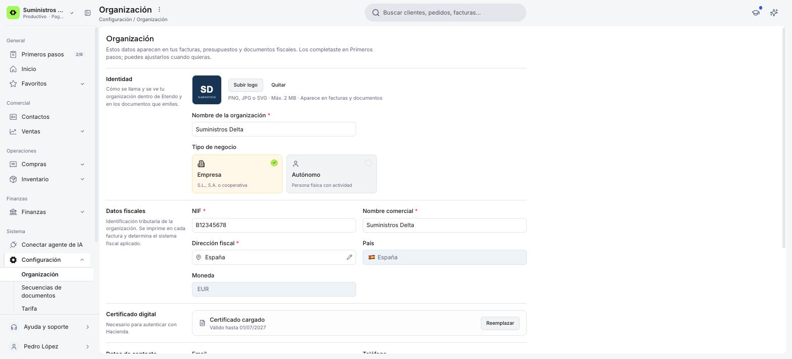
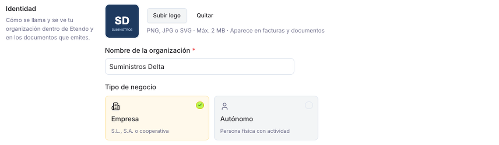
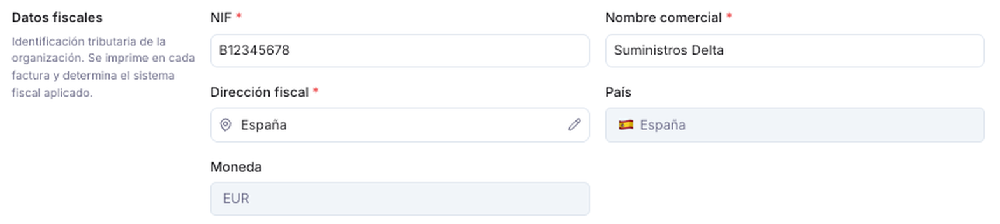
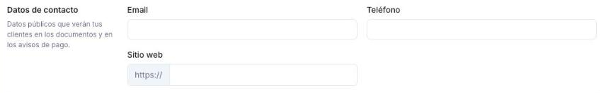
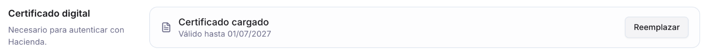
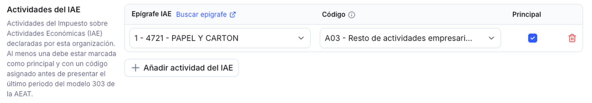
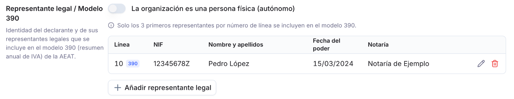
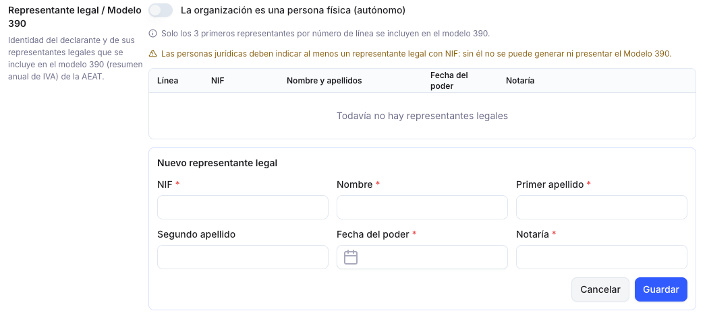
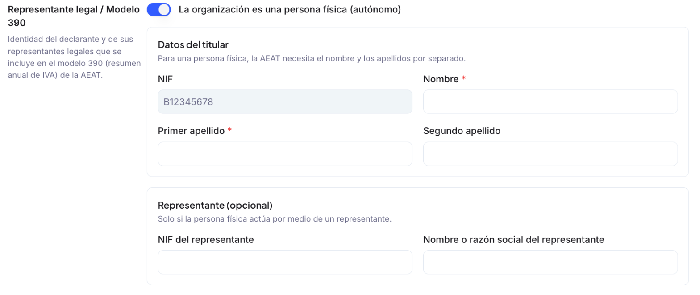
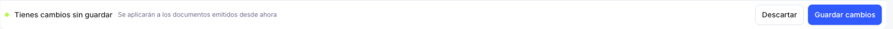

# Cómo gestionar tu organización

Los datos de tu cuenta que completaste al registrarte (identidad, datos fiscales y de contacto) no quedan fijos: puedes revisarlos y ajustarlos en cualquier momento desde la ventana **Organización**, dentro de **Configuración**. Estos datos son los que aparecen en tus facturas, presupuestos y demás documentos fiscales.

## Acceder a la ventana Organización

1. En el menú lateral, dentro de la sección **Sistema**, haz clic en **Configuración**.
2. Selecciona **[Organización](https://app.etendo.ai/organization){target="_blank"}**, la primera opción del submenú.

## Datos de tu organización

La ventana Organización tiene tres bloques que ves siempre: **Identidad**, **Datos fiscales** y **Datos de contacto**. Además, puede mostrar hasta tres secciones fiscales (**Certificado digital**, **Actividades del IAE** y **Representante legal / Modelo 390**) que solo aparecen cuando tu configuración fiscal las necesita; se explican en [Secciones fiscales](#secciones-fiscales).

## Identidad

Define cómo se llama y se ve tu organización dentro de Etendo y en los documentos que emites.

- **Logo** — imagen que representa a tu organización en facturas y demás documentos. Formatos admitidos: PNG, JPG o SVG (máx. 2 MB). Haz clic en **Subir logo** para cargarla, o en **Quitar** para eliminarla.
- **Nombre de la organización** — nombre con el que identificas tu cuenta dentro de Etendo. Campo obligatorio.
- **Tipo de negocio** — elige entre **Empresa** (sociedades como S.L. o S.A., o cooperativas) o **Autónomo** (persona física con actividad).

## Datos fiscales

Es la identificación tributaria de tu organización: se imprime en cada factura y determina el sistema fiscal aplicado.

!!! info "Mismos datos, otro nombre"
    **NIF** y **Nombre comercial** son los mismos datos que completaste al [crear tu cuenta](../../../primeros-pasos/como-crear-tu-cuenta/como-crear-tu-cuenta.md#introduce-los-datos-de-tu-empresa), donde el formulario los llama **Identificación fiscal (NIF)** y **Nombre de la empresa**.

- **NIF** — identificación tributaria de tu organización. Campo obligatorio.
- **Nombre comercial** — nombre con el que aparece tu organización en facturas y demás documentos fiscales. Campo obligatorio.
- **Dirección fiscal** — dirección fiscal de tu organización. Campo obligatorio. Se edita desde una ventana aparte; consulta [Editar la dirección fiscal](#editar-la-direccion-fiscal).
- **País** y **Moneda** — solo informativos: no se editan desde esta pantalla, quedan fijados según lo que elegiste al crear la cuenta.

!!! info "País y moneda fijos"
    Si necesitas cambiar el país o la moneda de tu organización, contacta con soporte de Etendo; no es un ajuste que puedas hacer tú mismo desde Configuración.

### Editar la dirección fiscal

1. Haz clic en el ícono de lápiz, junto a la dirección.
2. Completa **Primera línea**, **Segunda línea**, **Código postal**, **Ciudad**, **País** y **Región**.
3. Haz clic en **Guardar** para confirmar la dirección y cerrar la ventana.

## Datos de contacto

Son los datos públicos que verán tus clientes en los documentos y en los avisos de pago.

- **Email** — dirección de correo de contacto de tu organización.
- **Teléfono** — número de contacto de tu organización.
- **Sitio web** — dirección de tu sitio, se completa después de `https://`.

## Secciones Fiscales

Estas secciones solo aparecen cuando las vas a usar. Dependen de los modelos que tengas activos en el [Catálogo de modelos](../../../impuestos/glosario-de-impuestos/glosario-de-impuestos.md#catalogo-de-modelos) y del sistema fiscal configurado en [Configuración Fiscal](https://app.etendo.ai/fiscal-config){target="_blank"}:

| Sección | Aparece si… | Para qué se usa |
| --- | --- | --- |
| **Certificado digital** | Tienes configurado un sistema fiscal (SII, TicketBAI o VERI\*FACTU), o está activo el Modelo 303 o el Modelo 390 | Autenticar tus envíos y presentaciones ante la administración tributaria |
| **Actividades del IAE** | Está activo el Modelo 303 o el Modelo 390 | Declarar la actividad económica de tu organización en esos modelos |
| **Representante legal / Modelo 390** | Está activo el Modelo 390 | Identificar al declarante y a sus representantes en el resumen anual de IVA |

Por ejemplo, si solo tienes activo el [Modelo 349](../../../impuestos/modelo-349/modelo-349.md) y ningún sistema fiscal, no ves ninguna de las tres: ninguna depende del Modelo 349.

!!! info "Ocultar una sección no borra sus datos"
    Si desactivas un modelo, su sección deja de mostrarse, pero los datos que guardaste se conservan y vuelven a aparecer al activarlo de nuevo.

### Certificado Digital

Muestra si hay un certificado cargado y hasta qué fecha es válido. Con **Reemplazar** subes uno nuevo. Es el mismo certificado que ves en las pestañas **SII** y **TicketBAI** de Configuración Fiscal, y el que usa la presentación telemática del [Modelo 303](../../../impuestos/modelo-303/modelo-303.md#el-detalle-de-una-declaracion).

### Actividades del IAE

Recoge las actividades del **Impuesto sobre Actividades Económicas (IAE)** que tu organización tiene declaradas. Antes de presentar el último período del año del Modelo 303 (el 4T o diciembre), al menos una tiene que estar marcada como **Principal** y tener un **Código** asignado.

1. Haz clic en **+ Añadir actividad del IAE**.
2. Elige el **Epígrafe IAE**. Si no lo conoces, haz clic en **Buscar epígrafe**, junto al título de la columna: abre el buscador de epígrafes de la Agencia Tributaria en una pestaña nueva.
3. Elige el **Código**, la clave de actividad que pide la AEAT (por ejemplo, *A03 - Resto de actividades empresariales…*), y marca **Principal** si es tu actividad principal.
4. Haz clic en el ícono ✓ para guardar la fila (o en ✕ para descartarla). La actividad se guarda en ese momento: no hace falta pulsar **Guardar cambios**.

Para quitar una actividad, haz clic en el ícono de papelera de su fila. Se borra al instante, sin pedir confirmación.

### Representante Legal / Modelo 390

Identifica al declarante y a sus representantes legales tal como los pide el Modelo 390 (resumen anual de IVA). Lo que tienes que completar depende de si tu organización es una persona jurídica o una persona física.

**Si tu organización es una sociedad (persona jurídica)**, deja apagado el interruptor **La organización es una persona física (autónomo)** y añade a sus representantes legales:

1. Haz clic en **+ Añadir representante legal**. Se abre el formulario **Nuevo representante legal**:

    

2. Completa **NIF**, **Nombre**, **Primer apellido**, **Fecha del poder** (la fecha de la escritura que le otorga el poder) y **Notaría** (todos obligatorios) y, si lo tiene, el **Segundo apellido**.
3. Haz clic en **Guardar**. El representante se guarda en ese momento, sin pasar por **Guardar cambios**, y aparece en la lista con su número de **Línea**. Los que se incluirán en el Modelo 390 llevan la etiqueta **390**.

Con el lápiz de cada fila editas un representante y con la papelera lo eliminas (se borra al instante, sin pedir confirmación).

!!! warning "Sin representante, no hay Modelo 390"
    Una persona jurídica necesita al menos un representante legal con NIF para generar o presentar el Modelo 390: mientras no haya ninguno, la sección lo avisa en naranja. Si añades más de tres, solo se incluyen los tres primeros por número de **Línea**.

**Si eres autónomo (persona física)**, activa el interruptor **La organización es una persona física (autónomo)**. La lista de representantes se sustituye por dos bloques:

- **Datos del titular** — el **NIF** se toma de los datos fiscales de la organización y no se edita aquí. Completa **Nombre** y **Primer apellido** (obligatorios) y el **Segundo apellido** si lo tienes: la administración tributaria pide el nombre y los apellidos por separado.
- **Representante (opcional)** — solo si presentas por medio de un representante: **NIF del representante** y **Nombre o razón social del representante**. Completa los dos o ninguno: si solo rellenas uno, al guardar aparece el error *"Debe rellenar ambos, el NIF y el nombre (o razón social) del representante legal, o dejar los dos vacíos"*.

A diferencia de la lista de representantes, el interruptor y estos datos se guardan con **Guardar cambios**, en la barra inferior.

## Guardar los cambios

Ahora que ya conoces los bloques de datos, conviene saber cómo se guardan los cambios. Hay dos mecanismos:

- **Fila a fila, al instante** — las actividades del IAE y los representantes legales se guardan al confirmar cada fila, como se explica en sus secciones.
- **Con la barra inferior** — el resto de datos (Identidad, Datos fiscales, Datos de contacto y los datos de persona física del Modelo 390).

Apenas modificas uno de estos últimos campos, aparece al pie de la pantalla una barra con el aviso **Tienes cambios sin guardar** y dos botones:

- **Guardar cambios** — aplica los ajustes.
- **Descartar** — vuelve a los valores anteriores sin guardar nada.

!!! tip "Qué pasa con los documentos ya emitidos"
    Los cambios se aplican a los documentos que emitas desde ese momento en adelante. Las facturas y demás documentos que ya emitiste no se modifican.

## Artículos Relacionados

- [Cómo crear tu cuenta](../../../primeros-pasos/como-crear-tu-cuenta/como-crear-tu-cuenta.md) — el registro inicial en el que completas por primera vez estos mismos datos.
- [Modelo 303](../../../impuestos/modelo-303/modelo-303.md) — el modelo que hace aparecer las secciones Certificado digital y Actividades del IAE.
- [Cómo Activar tu Sistema Fiscal](../../../impuestos/como-activar-un-modelo-tributario/como-activar-un-modelo-tributario.md) — configura el sistema fiscal (SII, TicketBAI o VERI\*FACTU) que hace aparecer la sección Certificado digital.

---
Esta obra está bajo la licencia :material-creative-commons: :fontawesome-brands-creative-commons-by: :fontawesome-brands-creative-commons-sa: [CC BY-SA 2.5 ES](https://creativecommons.org/licenses/by-sa/2.5/es/){target="_blank"} de [Futit Services S.L](https://etendo.software){target="_blank"}.
